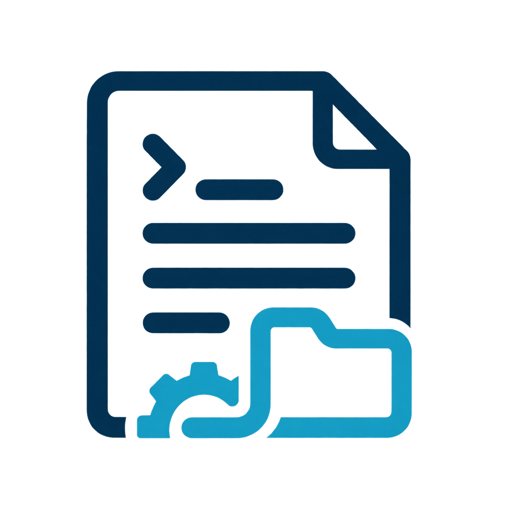
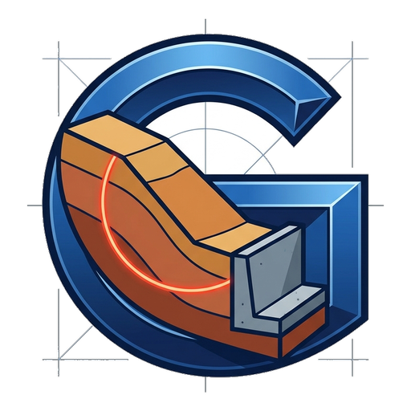
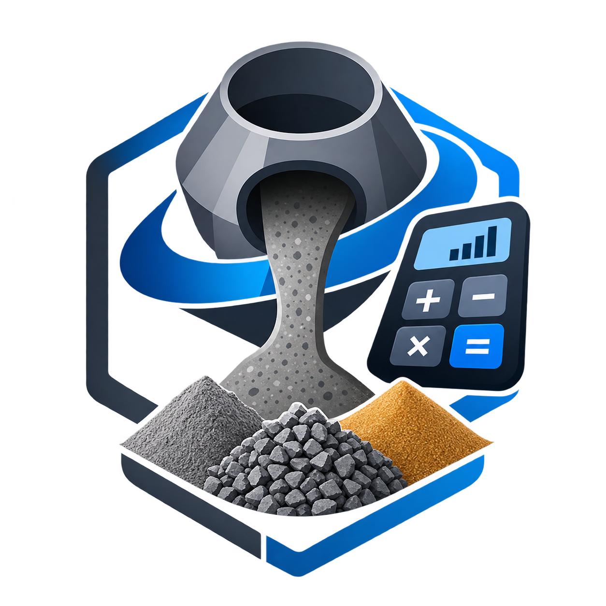
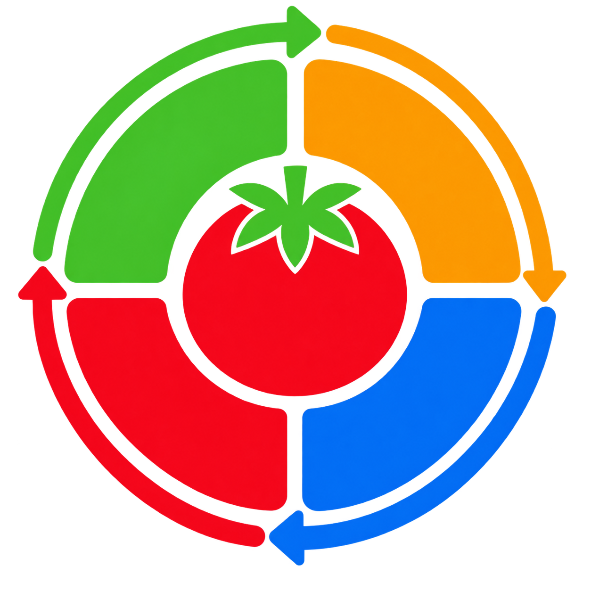
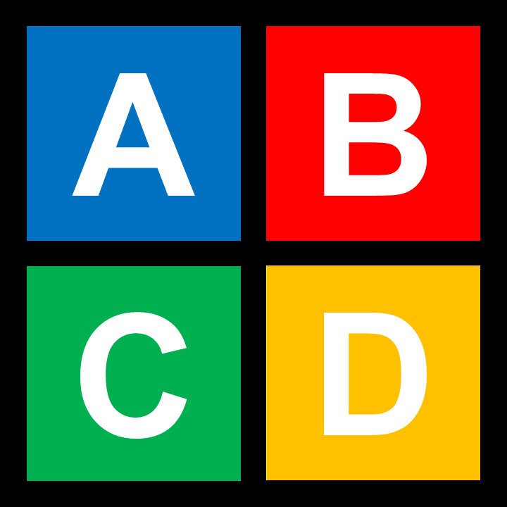

<!-- Multilanguage README.md for fernandoncidade Profile -->

  <b>Selecione o idioma / Select language:</b> 
  <a href="#ptbr">🇧🇷 Português (BR)</a> |
  <a href="#enus">🇺🇸 English (US)</a>

---

<h2 id="ptbr">🇧🇷 Português (BR)</h2>

> # Olá, eu sou o Fernando Nillsson Cidade! 👋

Clique para expandir o README em português

  
  
  

## 📊 Estatísticas dos Meus Repositórios

### 🕒 Total de Tempo Trabalhado: 48834.7h <!-- TOTAL_HOURS_PLACEHOLDER -->
### 📝 Total de Linhas Escritas: 550290 <!-- TOTAL_LINES_PLACEHOLDER -->
### 💻 Total de Commits: 412 <!-- TOTAL_COMMITS_PLACEHOLDER -->

## 📈 Detalhamento por Repositório

> Gerado automaticamente a partir da API pública do GitHub; repositórios privados e forks não entram neste relatório.

<!-- PUBLIC_REPOS_STATS_PT_START -->
| Repositório | Linguagem | Horas | Linhas | Commits | Produtividade (L/H) |
|-------------|-----------|-------|--------|---------|---------------|
| ACL_Auditor_cpp | C++ | 2542.8h | 21190 | 1 | 8.33 l/h |
| Agenda_Avaliacoes_Academicas | Python | 523.6h | 6545 | 11 | 12.50 l/h |
| Agenda_Avaliacoes_Academicas_cpp | C++ | 911.5h | 7596 | 3 | 8.33 l/h |
| Compare_Following_Follower | Python | 886.3h | 11079 | 5 | 12.50 l/h |
| Compression_Manager | Python | 569.9h | 5480 | 14 | 9.62 l/h |
| Concrete_Mix_Designer_cpp | C++ | 2592.2h | 21602 | 2 | 8.33 l/h |
| Dashboard_Streamlit-Plotly-Pandas_Management | Python | 58.5h | 1170 | 8 | 20.00 l/h |
| Dashboard_Streamlit-Plotly-Pandas_Pareto-Diagram_ABC-Curve | Python | 55.8h | 1116 | 3 | 20.00 l/h |
| Dashboard_Taipy | Python | 6059.6h | 100994 | 3 | 16.67 l/h |
| Dashboard_TkInter_Pareto-Diagram_ABC-Curve | Python | 67.8h | 1356 | 1 | 20.00 l/h |
| EcoLZMA_cpp | C++ | 1430.0h | 11917 | 1 | 8.33 l/h |
| Economia_APP | Python | 857.9h | 10724 | 15 | 12.50 l/h |
| Economia_APP_cpp | C++ | 2707.4h | 22562 | 2 | 8.33 l/h |
| EoloPlatform_rs | Rust | 1063.5h | 15953 | 1 | 15.00 l/h |
| fernandoncidade | HTML | 383.9h | 11997 | 260 | 31.25 l/h |
| File_Manager | C++ | 534.9h | 8024 | 5 | 15.00 l/h |
| GeoEstabil_rs | Rust | 1589.0h | 23835 | 1 | 15.00 l/h |
| HuginnSentinel_rs | Rust | 3984.7h | 59770 | 2 | 15.00 l/h |
| Launcher_EBook | C++ | 352.2h | 3202 | 2 | 9.09 l/h |
| Linceu_Lighthouse_cpp | C++ | 16068.2h | 133902 | 1 | 8.33 l/h |
| Munin_App_cpp | C++ | 2077.0h | 17308 | 1 | 8.33 l/h |
| Programa_Carteira_Motorista | C++ | 21.5h | 387 | 2 | 18.00 l/h |
| Programa_Determinar_Maior_Inteiro | C++ | 10.0h | 150 | 2 | 15.00 l/h |
| Programa_Expressoes_Relacionais | C++ | 10.0h | 140 | 2 | 14.00 l/h |
| Programa_IMC | C++ | 10.0h | 169 | 2 | 16.90 l/h |
| Programa_Matriz_NM | C++ | 10.0h | 163 | 2 | 16.30 l/h |
| Programa_Media_Aritmetica | C++ | 21.4h | 385 | 2 | 17.99 l/h |
| Programa_Multiplo | C++ | 10.0h | 171 | 2 | 17.10 l/h |
| Programa_Quociente_Resto | C++ | 10.0h | 140 | 2 | 14.00 l/h |
| Programa_Todos_Tipos_Matrizes | C++ | 12.4h | 223 | 2 | 17.98 l/h |
| Programa_Urna_Eletronica | C++ | 744.4h | 11166 | 6 | 15.00 l/h |
| SlidingWindowLZ77_cpp | C | 2198.4h | 32976 | 1 | 15.00 l/h |
| sloth-highlander-theme-1 | CSS/HTML | 459.9h | 6898 | 45 | 15.00 l/h |
| **TOTAL** | - | 48834.7h | 550290 | 412 | - |
<!-- PUBLIC_REPOS_STATS_PT_END -->

## 🌻 Sobre Mim 🌻

Olá, eu sou o Fernando Nillsson Cidade! Graduando no Bacharelado em Engenharia Civil pela Universidade Federal do Paraná (UFPR) — tudo o que desenvolvo nasce de uma intensa atividade autodidata e de muita curiosidade científica e tecnológica. Desenvolvedor de software autodidata com sólida prática em C++ (C++17/C++20), Rust (Edições 2021/2024), C e Python (3.10+), dedicado ao estudo e implementação de arquitetura de sistemas nativos de altíssima performance, design de código limpo e seguro em memória, estruturas de dados e algoritmos avançados, paralelismo multi-core e vetorização SIMD, cibersegurança e auditoria forense de sistemas de arquivos, processamento massivo de logs em tempo real, simulação estrutural, eólica, geotécnica e de tecnologia do concreto (normas ABNT NBR), engenharia econômica, ciência de dados, compressão de dados, acessibilidade cognitiva para neurodivergentes e ferramentas de produtividade — aliando Qt6, egui/WGPU, Win32 API e bancos de dados relacionais locais com soberania total de dados (100% offline e zero telemetria).

## 🚀 Habilidades

Competências técnicas construídas de forma 100% autodidata e movidas por intensa curiosidade científica, paralelamente à minha graduação no Bacharelado em Engenharia Civil pela UFPR. Clique no título de qualquer habilidade abaixo para abrir sua tela exclusiva com a descrição completa de arquitetura, design de código, estruturas de dados, algoritmos e boas práticas:

<b>⚙️ Linguagens de Programação, Compiladores &amp; Padrões</b> — <a href="skills/linguagens-compiladores.html">🔗 Abrir tela exclusiva</a>

C++ (C++17 e C++20 — STL, templates, concepts, std::span, programação de sistemas e alto desempenho), Rust (Edições 2021 e 2024 — segurança estrita de memória em tempo de compilação, ownership/borrowing, lifetimes, traits e binários CLI/GUI nativos), C (C99/C11 — manipulação binária, ponteiros e algoritmos de baixo nível), Python (3.10+ — Type Hints, PEP 8, automação, ciência de dados e aplicações desktop), Tecnologias Web (HTML5 Semântico, CSS3 Moderno com Grid/Flexbox e Variáveis CSS, JavaScript ES6+ Vanilla) e toolchains de compilação nativa (MSVC 2022, Clang/LLVM, MinGW-w64/GCC, Cargo/Rustc, CMake e Git/GitHub).

<b>🏛️ Arquitetura de Software &amp; Padrões de Projeto</b> — <a href="skills/arquitetura-software.html">🔗 Abrir tela exclusiva</a>

Arquitetura Limpa e em Camadas (desacoplamento estrito entre Apresentação/UI, Domínio/Regras de Negócio e Persistência/Acesso a Dados), Arquitetura Orientada a Eventos (Signals &amp; Slots e despachantes assíncronos), Modelo de Atores e Produtor-Consumidor (workers dedicados de persistência como DbWriter e filas assíncronas), padrão Model-View-Delegate (QAbstractTableModel e QItemDelegate com validação in-place), arquitetura de janelas não-modais (Modeless Dialogs com Z-Order independente), sistemas extensíveis por módulos/plugins, internacionalização bilíngue nativa em tempo real (I18N PT-BR/EN-US) e arquitetura 100% Local-First / Zero-Trust Offline com soberania total de dados e zero telemetria.

<b>💎 Design de Código, Lógica Computacional &amp; Boas Práticas de Programação</b> — <a href="skills/design-codigo-boas-praticas.html">🔗 Abrir tela exclusiva</a>

Aplicação rigorosa dos princípios SOLID, Clean Code, DRY (Don't Repeat Yourself), KISS e YAGNI, gerenciamento determinístico de recursos via RAII (Resource Acquisition Is Initialization) e ponteiros inteligentes (std::unique_ptr e std::shared_ptr), semântica de movimentação (Move Semantics) e leitura Zero-Copy sem alocações desnecessárias no heap, concorrência sem condições de corrida (Fearless Concurrency em Rust e sincronização segura em C++), programação defensiva com validação de invariantes e contratos, tipagem estática forte, persistência transacional atômica contra falhas de energia (Write-Replace via ReplaceFileW e commits ACID), cancelamento cooperativo de threads operárias e empacotamento certificado para a Microsoft Store (12 aplicativos publicados).

<b>🧮 Estruturas de Dados, Algoritmos &amp; Complexidade Computacional</b> — <a href="skills/estruturas-dados-algoritmos.html">🔗 Abrir tela exclusiva</a>

Buffers circulares (Ring Buffers) e canais lock-free multi-producer multi-consumer (crossbeam-channel), tabelas de dispersão (Hash Sets e Hash Maps com busca e diferença/interseção de conjuntos em tempo constante O(1) para dezenas de milhares de registros), árvores hierárquicas e parsers estruturados (JSON DOM/SAX, XML e árvores de diretórios NTFS), grafos espaciais dirigidos por forças físicas (Force-Directed Graphs para mapas mentais), algoritmos de compressão sem perdas por janela deslizante (LZ77) e codificação de entropia/dicionário (LZMA), autômatos de expressões regulares compilados em código de máquina (Regex JIT via PCRE2 e QRegularExpression), algoritmos numéricos híbridos de busca de raízes polinomiais (Newton-Raphson e Brent-Dekker com derivadas analíticas), regressão não linear por Mínimos Quadrados (Least-Squares), linearização logarítmica, álgebra e inversão de matrizes e escalonamento paralelo por roubo de trabalho (Work-Stealing Thread Pools via Rayon, std::jthread e QThreadPool).

<b>⚡ Engenharia de Computação, Sistemas de Baixo Nível, SIMD &amp; Paralelismo</b> — <a href="skills/engenharia-computacao-baixo-nivel.html">🔗 Abrir tela exclusiva</a>

Programação de sistemas próxima ao hardware (arquitetura x86-64), mapeamento de arquivos diretamente no espaço de endereçamento virtual do kernel (Memory-Mapped Files via CreateFileMappingW e MapViewOfFile para abertura instantânea de arquivos de múltiplos gigabytes com RAM constante), vetorização de CPU com instruções SIMD de 256 e 128 bits (intrínsecos AVX2, AVX, SSE4.2 e SSE2 como _mm256_cmpeq_epi8 e _mm256_movemask_epi8 com fallback escalar dinâmico atingindo vazão superior a 3,0 GB/s), I/O assíncrono de kernel com buffers alinhados (ReadDirectoryChangesW e FindFirstFileExW com latência sub-milissegundo), streaming em blocos de memória limitada (memory-bounded chunks de 1 a 4 MB), temporização monotônica de alta precisão (std::chrono e QElapsedTimer), aritmética de ponto flutuante IEEE 754 de dupla precisão (64 bits) e integração nativa com subsistemas Win32 (Advapi32, Secur32, Netapi32, ShellExecuteW, DWM API e SAPI5/OneCore).

<b>🎨 Engenharia de Interfaces Gráficas (GUI), Renderização GPU &amp; Experiência do Usuário</b> — <a href="skills/interfaces-graficas-gpu.html">🔗 Abrir tela exclusiva</a>

Desenvolvimento desktop nativo com Qt 6 e Qt 6.11 (Qt Widgets, Qt Charts, QGraphicsView/QGraphicsScene, QPainter, QPdfWriter, QPalette, estilização avançada QSS e integração com Desktop Window Manager / Mica do Windows 11), interfaces reativas em modo imediato em Rust com egui/eframe, renderização gráfica 2D/3D acelerada por hardware na GPU (WGPU, DirectX 12, Vulkan e OpenGL para wireframes estruturais 3D interativos, diagramas vetoriais cromáticos de cargas e mapas de calor a 60 FPS estáveis), além de PySide6, PyQt6 e Tkinter em Python com suporte nativo a temas Claro/Escuro e escalonamento vetorial nítido em monitores HiDPI/4K.

<b>🛡️ Cibersegurança, Auditoria Forense, Criptografia &amp; Monitoramento de Integridade</b> — <a href="skills/ciberseguranca-auditoria-forense.html">🔗 Abrir tela exclusiva</a>

Monitoramento contínuo de integridade de arquivos em tempo real (File Integrity Monitoring — FIM) com correlação semântica determinística de eventos de kernel (detecção exata de RENAMED e MOVED sem falsos positivos), extração e análise binária de descritores de segurança do Windows (GetNamedSecurityInfoW, DACL, SACL, Owner, Primary Group e resolução rápida de SIDs com cache local), simulação do Security Reference Monitor para cálculo causal de Acesso Efetivo (GetEffectiveRightsFromAclW / Authz avaliando tokens, grupos aninhados e cadeias de herança NTFS/ReFS e SMB 3.0+), detecção automatizada de vulnerabilidades e vetores de escalonamento de privilégios (diretórios world-writable, SIDs órfãos e caminhos de serviços não citados / unquoted service paths), planos de remediação segura com rollback (snapshots icacls), quarentena forense, baselines criptográficas (SHA-256), criptografia simétrica autenticada (AES-256-CBC/GCM com derivação de chaves PBKDF2 e salt aleatório), cálculo determinístico de score de risco (0–100) e exportação de evidências para conformidade (LGPD, GDPR, SOC 2, ISO 27001, PCI-DSS e SOX).

<b>🏗️ Engenharia Civil, Estrutural &amp; Geotécnica Computacional (Normas ABNT NBR)</b> — <a href="skills/engenharia-civil-computacional.html">🔗 Abrir tela exclusiva</a>

Modelagem matemática analítica e verificação normativa automatizada: ações devidas ao vento em edificações e estruturas de aço (ABNT NBR 6123:2023 e NBR 8800:2024 — curvas isopléticas V0, banco de estações meteorológicas FAB, fatores S1/S2/S3, coeficientes de pressão externa/interna Cpe/Cpi, aberturas dominantes, reações lineares para pórticos/terças compatíveis com Ftool/SAP2000/CYPE/Eberick, arraste global e momento de tombamento), estabilidade de taludes e mecânica dos solos (ABNT NBR 11682:2009 e NBR 6122:2022 — equilíbrio limite por fatias pelos métodos de Bishop Simplificado iterativo, Fellenius e Janbu Simplificado com varredura paramétrica paralela em malhas de centros/raios, estratigrafia multicamadas Mohr-Coulomb, lençol freático/poropressão, mapa de calor contínuo de Fator de Segurança, empuxos de terra ativos/passivos de Rankine e Coulomb e capacidade de carga última de fundações por Hansen/Meyerhof), dimensionamento de estruturas de concreto armado e muros de arrimo de flexão Cantilever L/T e gravidade/gabião (ABNT NBR 6118:2023 — flexão simples no Domínio 3 dúctil, força cortante VRd1, controle de abertura de fissuras wk e detalhamento de bitolas comerciais para fuste, ponta e calcanhar) e dosagem experimental e racional de concreto de cimento Portland pelo Método IPT/EPUSP (ABNT NBR 12655:2022, NBR 7211:2022, NBR 7212:2025 e NBR 8953:2015 — leis de Abrams, Lyse e Molinari, empacotamento binário de britas, teor de argamassa seca alfa, nomograma de dosagem em 4 quadrantes, conversão para traço de canteiro com correção de umidade/inchamento, dimensionamento de padiolas e composição de custos por m³).

<b>📈 Engenharia Econômica, Finanças Quantitativas, Ciência de Dados &amp; Bancos de Dados</b> — <a href="skills/engenharia-economica-ciencia-dados.html">🔗 Abrir tela exclusiva</a>

Modelagem financeira de precisão contábil com arredondamento normativo ABNT (juros simples e compostos, séries uniformes/anuidades, gradientes aritméticos e geométricos e equivalência de taxas), sistemas de amortização (SAC, Francês/Price, SAM e Americano/Bullet), análise de viabilidade econômica de projetos (VPL/NPV, TIR/IRR, MTIR/MIRR, VAUE/EUAW e Payback simples e descontado) e depreciação patrimonial; arquitetura de bancos de dados relacionais embarcados com SQLite3 (modo concorrente WAL, PRAGMA synchronous=NORMAL, integridade referencial em cascata com Foreign Keys e catalogação histórica de até 58 categorias de metadados antes/depois); ciência de dados, estatística e Business Intelligence com Python (Taipy, Streamlit, Plotly, Pandas, NumPy, SciPy e Matplotlib), diagramas de Pareto, classificação por Curva ABC, boxplots de dispersão volumétrica, histogramas temporais (Time-Slice), consumo assíncrono de APIs REST (GitHub REST API v3 com autenticação Bearer e paginação RFC 5988) e geração nativa de relatórios e memoriais técnicos (PDF vetorial A4 300 DPI, HTML5, XLSX, CSV, JSON, XML, Markdown e SVG vetorial).

<b>🧠 Acessibilidade Cognitiva (A11y), Tecnologias Assistivas &amp; Metodologias de Produtividade</b> — <a href="skills/acessibilidade-cognitiva-produtividade.html">🔗 Abrir tela exclusiva</a>

Engenharia de software centrada em ergonomia cognitiva e neurodiversidade (Transtorno do Espectro Autista — TEA, TDAH e Dislexia) em conformidade com as diretrizes W3C WCAG 2.1 AAA, síntese de voz neural offline para leitura assistiva e audiolivros (QTextToSpeech e Win32 SAPI5/OneCore), navegabilidade integral por teclado com anéis de foco de alto contraste e integração semântica com leitores de tela (MSAA, UI Automation, NVDA e Narrator), tipografia especializada para dislexia, perfis de conforto sensorial livres de gatilhos visuais, catalogação assíncrona de bibliotecas digitais (PDF, EPUB, MOBI, DJVU e CBZ), gerenciamento acadêmico de avaliações e integração nativa de metodologias científicas de gestão de prioridades, foco profundo e aprendizagem ativa (Matriz de Decisão de Eisenhower em 4 quadrantes com Drag-and-Drop, Ciclos de Foco Pomodoro e Técnica Feynman).

## 🏪 Aplicativos na Loja da Microsoft (Microsoft Store)

| Aplicativo | Ícone | Descrição | Microsoft Store | Repositório |
|---|:---:|---|:---:|:---:|
| **Linceu Lighthouse** |  | Plataforma local de inteligência, histórico e auditoria de arquivos (FIM) |  |  |
| **ACL Auditor** |  | Auditoria de permissões NTFS & SMB, cálculo de acesso efetivo e riscos |  |  |
| **Munin App** |  | Leitor de logs massivos ultraveloz com Memory-Mapped Files e SIMD |  |  |
| **Huginn Sentinel** |  | Monitoramento contínuo de arquivos, histórico com 58 metadados e auditoria determinística |  |  |
| **Eolo Platform** |  | Ações de vento em edificações (ABNT NBR 6123:2023), modelagem 3D e memorial de cálculo |  |  |
| **GeoEstabil** |  | Estabilidade de taludes, empuxos de terra, fundações e muros de arrimo (ABNT NBR 11682 / 6122 / 6118) |  |  |
| **Concrete Mix Designer** |  | Dosagem experimental e racional de concreto pelo Método IPT/EPUSP e normas ABNT NBR |  |  |
| **EisenPo** |  | Gestão de tarefas por Matriz de Eisenhower com módulos Pomodoro e Feynman |  | — |
| **EISENHOWER ORGANIZER** |  | Organização e priorização ágil de tarefas pela Matriz de Eisenhower |  | — |
| **Lúmen** |  | Apoio a estudo, foco e organização para neurodivergentes (TEA, TDAH, Dislexia) |  | — |
| **COMPRESSION MANAGER** |  | Gerenciador de compressão e automação de backups multifórmato |  |  |
| **Economia APP** |  | Cálculos de Engenharia Econômica e finanças com passos detalhados |  |  |

---

## 🏮 Destaque de Projeto: Linceu Lighthouse

  

**Linceu Lighthouse**  
Plataforma desktop nativa em **C++17 e Qt6** para inteligência, rastreamento histórico e auditoria determinística do sistema de arquivos do Windows.
- **Monitoramento Semântico em Tempo Real:** Captura via APIs Win32 assíncronas (`ReadDirectoryChangesW`) com correlação de eventos complexos para identificação real de `RENAMED` e `MOVED`.
- **Inteligência Local sem IA:** Banco de dados relacional SQLite local enriquecido com mais de 30 categorias de metadados antes e depois de cada modificação, acompanhado por 17 visualizações gráficas nativas e mapas de calor.
- **Segurança e Linha de Base:** Linha de base criptográfica (baseline), cálculo determinístico de score de risco e exportação de relatórios auditáveis.
- **100% Local & Offline:** Zero nuvem, zero telemetria e isolamento completo.
- [Repositório GitHub: Linceu_Lighthouse_cpp](https://github.com/fernandoncidade/Linceu_Lighthouse_cpp)
- [Microsoft Web Store](https://apps.microsoft.com/detail/9NN8Z5Z700TM)
-    

## 🛡️ Destaque de Projeto: ACL Auditor

  

**ACL Auditor**  
Auditor enterprise-grade de permissões NTFS e compartilhamentos SMB no Windows, construído nativamente em **C++20 e Qt 6.11**.
- **Análise de Acesso Efetivo (Effective Access):** Responde com exatidão causal o motivo pelo qual um usuário ou grupo possui determinada permissão, simulando tokens, grupos aninhados e regras de herança.
- **Detecção de Riscos e Conformidade:** Identifica vulnerabilidades de segurança, diretórios graváveis por todos (*world-writable*), SIDs órfãos e caminhos de escalonamento de privilégios em serviços do Windows (caminhos não citados / *unquoted paths*).
- **Remediação Segura com Rollback:** Gera planos de remediação auditáveis garantindo backup obrigatório (`icacls /save`) e restauração segura (`icacls /restore`).
- **Relatórios Auditáveis:** Exportação completa de snapshots e relatórios técnicos em HTML e PDF.
- [Repositório GitHub: ACL_Auditor_cpp](https://github.com/fernandoncidade/ACL_Auditor_cpp)
- [Microsoft Web Store](https://apps.microsoft.com/detail/9NX5XZLL8WXW)
-    

## ⚡ Destaque de Projeto: Munin App

  

**Munin App**  
Visualizador e analisador de logs massivos de altíssimo desempenho para Windows, arquitetado em **C++20 com Qt6**.
- **Abertura Instantânea de Gigabytes:** Leitura *zero-copy* sob demanda via *Memory-Mapped Files* Win32 (`CreateFileMappingW` e `MapViewOfFile`), eliminando esgotamento de memória RAM.
- **Indexação SIMD > 3 GB/s:** Escaneamento vetorial ultrarrápido com instruções AVX2 e SSE4.2 com fallback escalar para indexar offsets em tempo recorde.
- **Busca Paralela Multi-Core:** Particionamento dinâmico entre todos os núcleos de CPU com suporte a Regex JIT e filtragem instantânea de linhas.
- **Live Tail & Time-Slice:** Acompanhamento contínuo em tempo real via eventos do kernel sem loops de polling e histograma temporal de distribuição de volume por carimbos de data/hora.
- **Inspetor Hierárquico JSON:** Dissecação e árvore formatada com realce sintático para logs estruturados modernos.
- [Repositório GitHub: Munin_App_cpp](https://github.com/fernandoncidade/Munin_App_cpp)
- [Microsoft Web Store](https://apps.microsoft.com/detail/9PP4GVHR5THC)
-    

## 🦅 Destaque de Projeto: Huginn Sentinel

  

**Huginn Sentinel**  
Plataforma desktop nativa em **Rust (2021/2024)** com interface gráfica em modo imediato via **egui/eframe** e aceleração gráfica por hardware (OpenGL/WGPU) para visibilidade total, histórico estruturado e auditoria determinística do sistema de arquivos do Windows.
- **Monitoramento Contínuo em Tempo Real:** Captura via APIs Win32 assíncronas (`ReadDirectoryChangesW`, engine `notify` e canais `crossbeam-channel`), com correlação semântica precisa de eventos (`RENAMED` e `MOVED` reais sem falsos registros de exclusão).
- **Histórico Pesquisável e Inteligência sem IA:** Banco de dados relacional SQLite local (`rusqlite` em modo WAL, escrita desacoplada em background com `DbWriter`), enriquecido com 58 categorias abrangentes de metadados antes e depois de cada alteração, análises estatísticas com boxplots de dispersão volumétrica e 17 visualizações gráficas nativas.
- **Segurança, Auditoria e Integridade:** Linha de base criptográfica (hashes SHA-256), cálculo determinístico de score de risco (0–100), quarentena segura de arquivos e exportação forense (XLSX, CSV, JSON, XML, TXT e SQLite).
- **100% Local & Offline (Local-First):** Zero nuvem, zero telemetria, sem contas e sem modelos de IA/LLM — total soberania de dados.
- [Repositório GitHub: HuginnSentinel_rs](https://github.com/fernandoncidade/HuginnSentinel_rs)
- [Microsoft Web Store](https://apps.microsoft.com/detail/9NHQTGB26LMK)
-     

## 🏗️ Destaque de Projeto: Concrete Mix Designer

  

**Concrete Mix Designer**  
Aplicação desktop de alta precisão em **C++20 e Qt6** para dosagem experimental e racional de concreto de cimento Portland pelo **Método IPT/EPUSP** (Helene & Terzian, 1992).
- **Modelagem Matemática Completa:** Integração rigorosa das leis de Abrams (exponencial e polinomial), Lyse (linear) e Molinari (hiperbólica), empacotamento binário de agregados graúdos e determinação experimental do teor de argamassa seca ($\alpha$).
- **Diagrama de Dosagem IPT em 4 Quadrantes:** Renderização interativa de curvas de regressão via Qt Charts e exportação vetorial em alta resolução (PNG e PDF).
- **Conformidade Normativa Automatizada:** Verificação instantânea de requisitos das normas ABNT NBR 12655:2022, NBR 6118:2023, NBR 7211:2022, NBR 7212:2025 e NBR 8953:2015.
- **Traço de Canteiro, Padiolas e Custos:** Conversão de traços de laboratório para canteiro com correção de umidade livre, dimensionamento de padiolas padrão (35 cm × 45 cm), tolerâncias de pesagem de centrais e análise comparativa de custos por $m^3$.
- **Relatórios Técnicos de Engenharia:** Memorial de cálculo detalhado com exportação nativa em PDF A4 (300 DPI), HTML5 e Markdown (.md).
- [Repositório GitHub: Concrete_Mix_Designer_cpp](https://github.com/fernandoncidade/Concrete_Mix_Designer_cpp)
- [Microsoft Web Store](https://apps.microsoft.com/detail/9PB3M1HPF8M4)
-     

## 💨 Destaque de Projeto: Eolo Platform

  

**Eolo Platform**  
Plataforma desktop de engenharia estrutural nativa em **Rust (2021/2024)** com interface reativa em **egui/eframe** e aceleração gráfica por hardware (WGPU/GPU) para cálculo, simulação e determinação de **ações devidas ao vento em edificações** em rigorosa conformidade com a norma **ABNT NBR 6123:2023** e **ABNT NBR 8800:2024**.
- **Parâmetros Meteorológicos e Fatores de Vento:** Velocidade básica V₀ por curvas isopléticas e banco de dados integrado de estações FAB (Tabela C.1), fatores S₁ (topográfico), S₂ (rugosidade do terreno I a V e classes dimensionais A/B/C) e S₃ (fator estatístico/ocupação), determinando a velocidade característica V_k e a pressão dinâmica q (kN/m² e kgf/m²).
- **Geometria Paramétrica e Tipologias Estruturais:** Suporte a galpões com telhado a duas águas simétrico (Tabela 7), uma água (Tabela 8), coberturas em arco/abóbadas cilíndricas, sheds industriais com lanternim e marquises isoladas. Determinação automatizada de coeficientes de pressão externa (Cpe) para paredes e telhados com zonas de alta sucção nas bordas e oitões.
- **Aberturas, Permeabilidade e Coeficiente Interno (Cpi):** Modelagem de faces permeáveis e aberturas dominantes, cálculo das combinações críticas de sobrepressão e sucção/arrancamento (Δp) e conversão em cargas distribuídas lineares (kN/m) para pórticos e terças prontas para softwares de análise matricial (Ftool, SAP2000, CYPE, Eberick).
- **Diagrama de Cargas com Wireframe 3D na GPU:** Renderização interativa do modelo estrutural em 3D e corte transversal 2D com flechas vetoriais cromáticas de sobrepressão e arrancamento nas terças, pilares e vigas para incidências a 0° e 90°, além de cálculo do arraste global (F_a) e momento de tombamento.
- **Memorial de Cálculo e Exportação Estrutural:** Geração instantânea de memorial de cálculo completo e auditável com exportação em HTML/PDF, Markdown (.md), JSON e cópia de texto.
- **100% Local-First & Offline:** Totalmente autônomo, sem telemetria, sem nuvem e sem bibliotecas externas pesadas.
- [Repositório GitHub: EoloPlatform_rs](https://github.com/fernandoncidade/EoloPlatform_rs)
- [Microsoft Web Store](https://apps.microsoft.com/detail/9NHTCM7PZ9MM)
-      

## ⛰️ Destaque de Projeto: GeoEstabil

  

**GeoEstabil**  
Ferramenta desktop nativa em **Rust (Edição 2021)** com interface gráfica em modo imediato via **egui/eframe** e utilitário de linha de comando (`geoestabil-cli.exe`) para estudo acadêmico, ensino e análise computacional de **estabilidade de taludes**, **empuxos de terra**, **fundações** e **dimensionamento de muros de arrimo** com base nas formulações de referência das normas **ABNT NBR 11682:2009**, **ABNT NBR 6122:2022** e **ABNT NBR 6118:2023**.
- **Motor de Estabilidade de Taludes com Paralelismo em CPU (`Rayon`):** Métodos de Equilíbrio Limite por Fatias (**Bishop Simplificado** iterativo com $m_\alpha$, **Fellenius** e **Janbu Simplificado** com fator corretivo $f_0$), varredura paramétrica paralela sobre malhas de centros $(X_c, Y_c)$ e raios $R$, múltiplas camadas Mohr-Coulomb ($c', \phi', \gamma, \gamma_{\text{sat}}$), lençol freático (poropressão $u$), sobrecarga ($q$) e **Mapa de Calor (Heatmap FS)** contínuo.
- **Muros de Contenção e Fundações:** Suporte a **Muros de Flexão em Concreto Armado (Perfil L/T Cantilever)** e **Muros de Gravidade (Concreto Ciclópico / Gabião)** com dente de ancoragem opcional, empuxos ativos e passivos por **Rankine** e **Coulomb**, cunha hidrostática e verificações de Tombamento ($FS \ge 1{,}50$), Deslizamento ($FS \ge 1{,}50$), Excentricidade ($e \le B/6$) e Capacidade de Carga Última por **Hansen/Meyerhof** ($FS \ge 2{,}00$).
- **Dimensionamento Estrutural em Concreto Armado (ABNT NBR 6118:2023):** Cálculo à flexão simples (Domínio 3 dúctil $\xi \le 0{,}45$), taxa mínima ($\rho_{\min} = 0{,}15\%$), cortante sem estribos ($V_{Rd1} \ge V_d$), estimativa de abertura de fissuras ($w_k \le 0{,}30\text{ mm}$) e sugestão de bitolas comerciais ($\varnothing 8{,}0$ a $\varnothing 25{,}0\text{ mm}$) para **Fuste**, **Ponta** e **Calcanhar**.
- **Memorial de Cálculo, SVG Vetorial & Persistência Local:** Exportação direta de relatórios em HTML5/PDF (A4), Markdown (`.md`) e perfis vetoriais SVG (`.svg`), manual bilíngue integrado e persistência 100% local e offline em SQLite (`geoestabil.db`) e arquivos `.geoestabil`.
- [Repositório GitHub: GeoEstabil_rs](https://github.com/fernandoncidade/GeoEstabil_rs)
- [Microsoft Web Store](https://apps.microsoft.com/detail/9P9BDZ9RHRC7)
-      

## 📋 Destaque de Projeto: EisenPo

  

**EisenPo**  
Aplicação desktop nativa em **C++ e Qt6** para organização e priorização de tarefas com base na Matriz de Eisenhower (Urgente/Importante).
- **Quatro Quadrantes Dinâmicos:** Classificação ágil entre tarefas pendentes e concluídas com movimentação automática.
- **Exportação & Importação:** Suporte a planilhas Excel (XLSX), arquivos PDF estruturados e persistência local segura em JSON.
- **Módulos e Plugins Opcionais:** Inclui módulo de foco Pomodoro com ciclos de trabalho/pausa sincronizados e integração com o Método Feynman para aprendizado e revisão ativa de conceitos.
- **Visualização Temporal:** Calendário integrado para exibição de tarefas por dia, semana e mês.
- [Microsoft Web Store](https://apps.microsoft.com/detail/9MW96RN044TT)
-   

## 🌟 Destaque de Projeto: Lúmen

  

**Lúmen**  
Aplicativo desktop em **C++ e Qt6** voltado para apoiar jovens e adultos neurodivergentes (TEA, TDAH, Dislexia) no estudo, foco e organização pessoal.
- Integra leitor acessível com vozes neurais, ferramentas de priorização de tarefas, timers Pomodoro com alertas visuais suaves, mapas mentais e recursos para explicação ativa (Método Feynman).
- [Microsoft Web Store](https://apps.microsoft.com/detail/9N70CLLMVRPN)
-   

## 🗂️ Destaque de Projeto: Eisenhower Organizer

  

**Eisenhower Organizer**  
Aplicativo leve e rápido para organizar tarefas usando a Matriz de Eisenhower (Importante/Urgente). Permite criar, classificar, marcar como concluídas e exportar/importar tarefas de forma simples e intuitiva.
- [Microsoft Web Store](https://apps.microsoft.com/detail/9P289X0185C3)
-  

## 📦 Destaque de Projeto: Compression Manager

  

**Compression Manager**  
Aplicativo desktop completo para automação de backups e compressão de arquivos. Conta com interface gráfica intuitiva, suporte a múltiplos formatos de arquivamento e perfis rápidos de backup.
- [Repositório GitHub: Compression_Manager](https://github.com/fernandoncidade/Compression_Manager)
- [Microsoft Web Store](https://apps.microsoft.com/detail/9PJMT90R953K)
-  

## 💰 Destaque de Projeto: Economia APP

  

**Economia APP**  
Ferramenta para cálculos financeiros e suporte à disciplina de Engenharia Econômica. Automatiza cálculos de juros simples e compostos, anuidades, gradientes, equivalência de taxas, tabelas de amortização (SAC, Price, SAM), análise de viabilidade de investimentos (VPL / VAUE) e depreciação com memória de cálculo detalhada.
- [Repositório GitHub: Economia_APP](https://github.com/fernandoncidade/Economia_APP)
- [Repositório GitHub: Economia_APP_cpp](https://github.com/fernandoncidade/Economia_APP_cpp)
- [Microsoft Web Store](https://apps.microsoft.com/detail/9PLR0KD6KSJJ)
-   

## 📚 Destaque de Projeto: Launcher EBook

  

**Launcher EBook**  
Aplicação desktop nativa em **C++/Qt6** para catalogar e-books e documentos locais, exibir metadados básicos, gerar estatísticas de acervo e abrir arquivos com aplicativos associados do sistema ou com um executável personalizado.
- [Repositório GitHub: Launcher_EBook](https://github.com/fernandoncidade/Launcher_EBook)
-  

## 👥 Destaque de Projeto: Compare - Following and Follower

  

**Compare - Following and Follower**  
Aplicativo desktop em Python/PySide6 para comparar, de forma prática e visual, quem você segue e quem te segue no GitHub, transformando grandes listas em relatórios claros para gestão do seu perfil.
- [Repositório GitHub: Compare_Following_Follower](https://github.com/fernandoncidade/Compare_Following_Follower)
-  

## 🎯 Principais Projetos

- [**Linceu Lighthouse**](https://github.com/fernandoncidade/Linceu_Lighthouse_cpp): Plataforma local de inteligência, histórico e auditoria determinística de atividades de arquivos no Windows (C++17 / Qt6 / SQLite).
- [**ACL Auditor**](https://github.com/fernandoncidade/ACL_Auditor_cpp): Auditor enterprise-grade de permissões NTFS e compartilhamentos SMB com análise de acesso efetivo e riscos (C++20 / Qt 6.11).
- [**Munin App**](https://github.com/fernandoncidade/Munin_App_cpp): Visualizador de logs massivos ultraveloz com Win32 Memory-Mapped Files e aceleração SIMD AVX2/SSE4.2 (C++20 / Qt6).
- [**Huginn Sentinel**](https://github.com/fernandoncidade/HuginnSentinel_rs): Plataforma local em Rust (egui/WGPU/SQLite) para monitoramento em tempo real, inteligência e auditoria determinística do sistema de arquivos do Windows.
- [**Eolo Platform**](https://github.com/fernandoncidade/EoloPlatform_rs): Plataforma de engenharia em Rust (egui/WGPU) para cálculo de ações de vento em edificações conforme ABNT NBR 6123:2023 com diagramas de carga 3D.
- [**GeoEstabil**](https://github.com/fernandoncidade/GeoEstabil_rs): Plataforma geotécnica e estrutural em Rust (egui/Rayon/SQLite) para estabilidade de taludes, empuxos de terra, fundações e muros de arrimo conforme ABNT NBR 11682:2009, NBR 6122:2022 e NBR 6118:2023.
- [**Concrete Mix Designer**](https://github.com/fernandoncidade/Concrete_Mix_Designer_cpp): Software de alta precisão em C++20/Qt6 para dosagem racional de concreto pelo Método IPT/EPUSP e normas ABNT NBR.
- [**Compression Manager**](https://github.com/fernandoncidade/Compression_Manager): Aplicativo completo de backup e compressão de arquivos com interface gráfica intuitiva.
- [**Economia APP**](https://github.com/fernandoncidade/Economia_APP): Ferramenta para cálculos financeiros e Engenharia Econômica com passos detalhados e histórico.
- [**Launcher EBook**](https://github.com/fernandoncidade/Launcher_EBook): Aplicação desktop em C++/Qt6 para catalogação de e-books e documentos locais.
- [**Agenda Avaliações Acadêmicas**](https://github.com/fernandoncidade/Agenda_Avaliacoes_Academicas): Sistema para gerenciamento de atividades avaliativas em ambientes educacionais, usando PySide6.
- [**Compare - Following and Follower**](https://github.com/fernandoncidade/Compare_Following_Follower): Aplicativo desktop para comparar seguidores e seguidos no GitHub.
- [**Programa Urna Eletrônica**](https://github.com/fernandoncidade/Programa_Urna_Eletronica): Sistema de votação eletrônica em C++, simulando urna com apuração automática.

## 📊 Dashboards de Análise de Dados
- [Streamlit/Plotly/Pandas Management](https://github.com/fernandoncidade/Dashboard_Streamlit-Plotly-Pandas_Management)
- [Pareto Diagram/ABC Curve](https://github.com/fernandoncidade/Dashboard_Streamlit-Plotly-Pandas_Pareto-Diagram_ABC-Curve)
- [TkInter Pareto/ABC](https://github.com/fernandoncidade/Dashboard_TkInter_Pareto-Diagram_ABC-Curve)

## 🎓 Formação Acadêmica & Trajetória Autodidata

*Graduando no Bacharelado em Engenharia Civil pela Universidade Federal do Paraná (UFPR). Todo o desenvolvimento de software, arquitetura de sistemas, estruturas de dados e algoritmos deste portfólio nasce de uma atividade autodidata contínua e de muita curiosidade científica, somada a estudos anteriores em Licenciatura em Física (UTFPR) e experiência em docência no Ensino Médio.*

## 🎯 Objetivos

- Aprimorar conhecimentos em automação, análise de dados e inteligência artificial.
- Ampliar o desenvolvimento de soluções open source e contribuir para a comunidade.
- Explorar novas tecnologias e padrões de desenvolvimento para entregar projetos cada vez mais robustos e eficientes.

  

## 📫 Contato

---

## 📈 Estatísticas GitHub

  

 <em><b>Sempre codando com paixão!</b> 🚀</em> 

  

---

<h2 id="enus">🇺🇸 English (US)</h2>

> # Hello, I'm Fernando Nillsson Cidade! 👋

Click to expand the README in English

  
  
  

## 📊 My Repository Statistics

### 🕒 Total Working Time: 48834.7h <!-- TOTAL_HOURS_PLACEHOLDER -->
### 📝 Total Lines Written: 550290 <!-- TOTAL_LINES_PLACEHOLDER -->
### 💻 Total Commits: 412 <!-- TOTAL_COMMITS_PLACEHOLDER -->

## 📈 Repository Breakdown

> Generated automatically from GitHub's public API; private repositories and forks are not included in this report.

<!-- PUBLIC_REPOS_STATS_EN_START -->
| Repository | Language | Hours | Lines | Commits | Productivity (L/H) |
|------------|----------|-------|-------|---------|--------------|
| ACL_Auditor_cpp | C++ | 2542.8h | 21190 | 1 | 8.33 l/h |
| Agenda_Avaliacoes_Academicas | Python | 523.6h | 6545 | 11 | 12.50 l/h |
| Agenda_Avaliacoes_Academicas_cpp | C++ | 911.5h | 7596 | 3 | 8.33 l/h |
| Compare_Following_Follower | Python | 886.3h | 11079 | 5 | 12.50 l/h |
| Compression_Manager | Python | 569.9h | 5480 | 14 | 9.62 l/h |
| Concrete_Mix_Designer_cpp | C++ | 2592.2h | 21602 | 2 | 8.33 l/h |
| Dashboard_Streamlit-Plotly-Pandas_Management | Python | 58.5h | 1170 | 8 | 20.00 l/h |
| Dashboard_Streamlit-Plotly-Pandas_Pareto-Diagram_ABC-Curve | Python | 55.8h | 1116 | 3 | 20.00 l/h |
| Dashboard_Taipy | Python | 6059.6h | 100994 | 3 | 16.67 l/h |
| Dashboard_TkInter_Pareto-Diagram_ABC-Curve | Python | 67.8h | 1356 | 1 | 20.00 l/h |
| EcoLZMA_cpp | C++ | 1430.0h | 11917 | 1 | 8.33 l/h |
| Economia_APP | Python | 857.9h | 10724 | 15 | 12.50 l/h |
| Economia_APP_cpp | C++ | 2707.4h | 22562 | 2 | 8.33 l/h |
| EoloPlatform_rs | Rust | 1063.5h | 15953 | 1 | 15.00 l/h |
| fernandoncidade | HTML | 383.9h | 11997 | 260 | 31.25 l/h |
| File_Manager | C++ | 534.9h | 8024 | 5 | 15.00 l/h |
| GeoEstabil_rs | Rust | 1589.0h | 23835 | 1 | 15.00 l/h |
| HuginnSentinel_rs | Rust | 3984.7h | 59770 | 2 | 15.00 l/h |
| Launcher_EBook | C++ | 352.2h | 3202 | 2 | 9.09 l/h |
| Linceu_Lighthouse_cpp | C++ | 16068.2h | 133902 | 1 | 8.33 l/h |
| Munin_App_cpp | C++ | 2077.0h | 17308 | 1 | 8.33 l/h |
| Programa_Carteira_Motorista | C++ | 21.5h | 387 | 2 | 18.00 l/h |
| Programa_Determinar_Maior_Inteiro | C++ | 10.0h | 150 | 2 | 15.00 l/h |
| Programa_Expressoes_Relacionais | C++ | 10.0h | 140 | 2 | 14.00 l/h |
| Programa_IMC | C++ | 10.0h | 169 | 2 | 16.90 l/h |
| Programa_Matriz_NM | C++ | 10.0h | 163 | 2 | 16.30 l/h |
| Programa_Media_Aritmetica | C++ | 21.4h | 385 | 2 | 17.99 l/h |
| Programa_Multiplo | C++ | 10.0h | 171 | 2 | 17.10 l/h |
| Programa_Quociente_Resto | C++ | 10.0h | 140 | 2 | 14.00 l/h |
| Programa_Todos_Tipos_Matrizes | C++ | 12.4h | 223 | 2 | 17.98 l/h |
| Programa_Urna_Eletronica | C++ | 744.4h | 11166 | 6 | 15.00 l/h |
| SlidingWindowLZ77_cpp | C | 2198.4h | 32976 | 1 | 15.00 l/h |
| sloth-highlander-theme-1 | CSS/HTML | 459.9h | 6898 | 45 | 15.00 l/h |
| **TOTAL** | - | 48834.7h | 550290 | 412 | - |
<!-- PUBLIC_REPOS_STATS_EN_END -->

## 🌻 About Me 🌻

Hello, I'm Fernando Nillsson Cidade! Undergraduate student in the Bachelor of Civil Engineering at the Federal University of Paraná (UFPR) — everything I develop stems from an intense self-taught activity and deep scientific and technological curiosity. Self-taught software developer with solid hands-on practice in C++ (C++17/C++20), Rust (2021/2024 Editions), C, and Python (3.10+), dedicated to studying and implementing ultra-high-performance native systems architecture, clean and memory-safe code design, advanced data structures and algorithms, multi-core parallelism and SIMD vectorization, cybersecurity and forensic file system auditing, real-time massive log processing, structural, wind, geotechnical, and concrete technology simulation (ABNT NBR standards), engineering economics, data science, data compression, cognitive accessibility for neurodivergent users, and productivity tooling — combining Qt6, egui/WGPU, the Win32 API, and local relational databases with total data sovereignty (100% offline and zero telemetry).

## 🚀 Skills

Technical competencies built through 100% self-taught study and driven by intense scientific curiosity, alongside my undergraduate studies in the Bachelor of Civil Engineering at UFPR. Click on any skill title below to open its dedicated screen with the complete description of architecture, code design, data structures, algorithms, and best practices:

<b>⚙️ Programming Languages, Compilers &amp; Standards</b> — <a href="skills/linguagens-compiladores.html">🔗 Open dedicated screen</a>

C++ (C++17 and C++20 — STL, templates, concepts, std::span, systems and high-performance programming), Rust (2021 and 2024 Editions — strict compile-time memory safety, ownership/borrowing, lifetimes, traits, and native CLI/GUI binaries), C (C99/C11 — binary manipulation, pointers, and low-level algorithms), Python (3.10+ — Type Hints, PEP 8, automation, data science, and desktop applications), Web Technologies (Semantic HTML5, Modern CSS3 with Grid/Flexbox and CSS Variables, Vanilla ES6+ JavaScript), and native build toolchains (MSVC 2022, Clang/LLVM, MinGW-w64/GCC, Cargo/Rustc, CMake, and Git/GitHub).

<b>🏛️ Software Architecture &amp; Design Patterns</b> — <a href="skills/arquitetura-software.html">🔗 Open dedicated screen</a>

Clean and Layered Architecture (strict decoupling across Presentation/UI, Domain/Business Logic, and Persistence/Data Access layers), Event-Driven Architecture (Signals &amp; Slots and asynchronous dispatchers), Actor and Producer-Consumer Models (dedicated persistence workers such as DbWriter and asynchronous queues), Model-View-Delegate pattern (QAbstractTableModel and QItemDelegate with in-place validation), modeless window architecture (Modeless Dialogs with independent Z-Order), modular/plugin-extensible systems, real-time native bilingual internationalization (PT-BR/EN-US I18N), and 100% Local-First / Zero-Trust Offline architecture with total data sovereignty and zero telemetry.

<b>💎 Code Design, Computational Logic &amp; Programming Best Practices</b> — <a href="skills/design-codigo-boas-praticas.html">🔗 Open dedicated screen</a>

Strict application of SOLID, Clean Code, DRY (Don't Repeat Yourself), KISS, and YAGNI principles, deterministic resource management via RAII (Resource Acquisition Is Initialization) and smart pointers (std::unique_ptr and std::shared_ptr), Move Semantics and Zero-Copy processing free of superfluous heap allocations, data-race-free concurrency (Fearless Concurrency in Rust and thread-safe synchronization in C++), defensive programming with invariant and contract validation, strong static typing, power-safe atomic transactional persistence (Write-Replace via ReplaceFileW and ACID commits), cooperative worker thread cancellation, and certified packaging for the Microsoft Store (12 published applications).

<b>🧮 Data Structures, Algorithms &amp; Computational Complexity</b> — <a href="skills/estruturas-dados-algoritmos.html">🔗 Open dedicated screen</a>

Circular Ring Buffers and lock-free multi-producer multi-consumer channels (crossbeam-channel), hash tables (Hash Sets and Hash Maps with O(1) constant-time lookup and set difference/intersection across tens of thousands of records), hierarchical trees and structured parsers (JSON DOM/SAX, XML, and NTFS directory trees), force-directed spatial graphs (Force-Directed Graphs for mind mapping), lossless compression algorithms via sliding window (LZ77) and dictionary/entropy encoding (LZMA), machine-code Just-In-Time compiled regular expression automata (Regex JIT via PCRE2 and QRegularExpression), hybrid numerical polynomial root-finding algorithms (Newton-Raphson and Brent-Dekker with analytical derivatives), non-linear Least-Squares regression, logarithmic linearization, matrix algebra and inversion, and parallel work-stealing scheduling (Work-Stealing Thread Pools via Rayon, std::jthread, and QThreadPool).

<b>⚡ Computer Engineering, Low-Level Systems, SIMD &amp; Parallelism</b> — <a href="skills/engenharia-computacao-baixo-nivel.html">🔗 Open dedicated screen</a>

Hardware-close systems programming (x86-64 architecture), direct virtual address space file mapping (Memory-Mapped Files via CreateFileMappingW and MapViewOfFile for instant multi-gigabyte file opening with constant RAM usage), CPU vectorization with 256-bit and 128-bit SIMD instructions (AVX2, AVX, SSE4.2, and SSE2 intrinsics such as _mm256_cmpeq_epi8 and _mm256_movemask_epi8 with dynamic scalar fallback exceeding 3.0 GB/s throughput), asynchronous kernel I/O with aligned completion buffers (ReadDirectoryChangesW and FindFirstFileExW with sub-millisecond dispatch), memory-bounded stream chunk processing (1 to 4 MB chunks), high-precision monotonic timing (std::chrono and QElapsedTimer), 64-bit IEEE 754 double-precision floating-point arithmetic, and native Win32 subsystem integration (Advapi32, Secur32, Netapi32, ShellExecuteW, DWM API, and SAPI5/OneCore).

<b>🎨 Graphical User Interface (GUI) Engineering, GPU Rendering &amp; User Experience</b> — <a href="skills/interfaces-graficas-gpu.html">🔗 Open dedicated screen</a>

Native desktop development with Qt 6 and Qt 6.11 (Qt Widgets, Qt Charts, QGraphicsView/QGraphicsScene, QPainter, QPdfWriter, QPalette, advanced QSS styling, and Windows 11 Desktop Window Manager / Mica integration), immediate-mode reactive interfaces in Rust with egui/eframe, hardware-accelerated 2D/3D GPU graphics rendering (WGPU, DirectX 12, Vulkan, and OpenGL for interactive 3D structural wireframes, chromatic vector load diagrams, and heatmaps at a steady 60 FPS), as well as PySide6, PyQt6, and Tkinter in Python with native Light/Dark theme support and crisp vector scaling on HiDPI/4K displays.

<b>🛡️ Cybersecurity, Forensic Auditing, Cryptography &amp; Integrity Monitoring</b> — <a href="skills/ciberseguranca-auditoria-forense.html">🔗 Open dedicated screen</a>

Continuous real-time File Integrity Monitoring (FIM) with deterministic semantic correlation of kernel events (exact RENAMED and MOVED detection without false positives), binary extraction and analysis of Windows security descriptors (GetNamedSecurityInfoW, DACL, SACL, Owner, Primary Group, and cached local SID resolution), Security Reference Monitor emulation for causal Effective Access evaluation (GetEffectiveRightsFromAclW / Authz evaluating tokens, nested groups, and NTFS/ReFS and SMB 3.0+ inheritance chains), automated detection of vulnerabilities and privilege escalation vectors (world-writable directories, orphaned SIDs, and unquoted service paths), safe remediation plans with rollback (icacls snapshots), forensic quarantine, cryptographic baselines (SHA-256), authenticated symmetric encryption (AES-256-CBC/GCM with PBKDF2 key derivation and random salt), deterministic risk score calculation (0–100), and compliance evidence export (GDPR, LGPD, SOC 2, ISO 27001, PCI-DSS, and SOX).

<b>🏗️ Computational Civil, Structural &amp; Geotechnical Engineering (ABNT NBR Standards)</b> — <a href="skills/engenharia-civil-computacional.html">🔗 Open dedicated screen</a>

Analytical mathematical modeling and automated code compliance: wind actions on buildings and steel structures (ABNT NBR 6123:2023 and NBR 8800:2024 — V0 isopleth maps, embedded FAB weather station database, S1/S2/S3 factors, external/internal pressure coefficients Cpe/Cpi, dominant openings, linear frame/purlin reactions compatible with Ftool/SAP2000/CYPE/Eberick, global drag, and overturning moment), slope stability and soil mechanics (ABNT NBR 11682:2009 and NBR 6122:2022 — method of slices limit equilibrium via iterative Simplified Bishop, Fellenius, and Simplified Janbu with parallel parametric grid search over slip centers/radii, multi-layer Mohr-Coulomb stratigraphy, water table/pore pressure, continuous Safety Factor heatmap, Rankine and Coulomb active/passive earth pressures, and Hansen/Meyerhof ultimate foundation bearing capacity), reinforced concrete and L/T cantilever and gravity/gabion retaining wall design (ABNT NBR 6118:2023 — ductile Domain 3 simple flexure, shear resistance VRd1, crack width control wk, and commercial rebar detailing for stem, toe, and heel), and experimental and rational Portland cement concrete mix proportioning via the IPT/EPUSP Method (ABNT NBR 12655:2022, NBR 7211:2022, NBR 7212:2025, and NBR 8953:2015 — Abrams, Lyse, and Molinari laws, binary coarse aggregate packing, dry mortar content alpha, 4-quadrant dosage nomogram, field batching conversion with moisture/bulking correction, gauging box sizing, and per-m³ cost analysis).

<b>📈 Engineering Economics, Quantitative Finance, Data Science &amp; Databases</b> — <a href="skills/engenharia-economica-ciencia-dados.html">🔗 Open dedicated screen</a>

Accounting-precision financial modeling with ABNT standard rounding (simple and compound interest, uniform series/annuities, arithmetic and geometric gradients, and interest rate equivalence), loan amortization systems (SAC, French/Price, SAM, and American/Bullet), project economic feasibility analysis (NPV/VPL, IRR/TIR, MIRR/MTIR, EUAW/VAUE, and simple and discounted Payback), and asset depreciation; embedded relational database architecture with SQLite3 (concurrent WAL mode, PRAGMA synchronous=NORMAL, cascading Foreign Key referential integrity, and historical tracking of up to 58 before/after metadata categories); data science, statistics, and Business Intelligence with Python (Taipy, Streamlit, Plotly, Pandas, NumPy, SciPy, and Matplotlib), Pareto diagrams, ABC Curve classification, volumetric dispersion boxplots, temporal Time-Slice histograms, asynchronous REST API consumption (GitHub REST API v3 with Bearer authentication and RFC 5988 pagination), and native generation of technical reports and calculation memorials (300 DPI vector A4 PDF, HTML5, XLSX, CSV, JSON, XML, Markdown, and vector SVG).

<b>🧠 Cognitive Accessibility (A11y), Assistive Technologies &amp; Productivity Methodologies</b> — <a href="skills/acessibilidade-cognitiva-produtividade.html">🔗 Open dedicated screen</a>

Software engineering centered on cognitive ergonomics and neurodiversity (Autism Spectrum Disorder — ASD, ADHD, and Dyslexia) in compliance with W3C WCAG 2.1 AAA guidelines, offline neural speech synthesis for assistive reading and audiobooks (QTextToSpeech and Win32 SAPI5/OneCore), full keyboard navigability with high-contrast focus rings and semantic screen reader integration (MSAA, UI Automation, NVDA, and Narrator), dyslexia-specialized typography, trigger-free sensory comfort presets, asynchronous digital library cataloging (PDF, EPUB, MOBI, DJVU, and CBZ), academic evaluation scheduling, and native integration of scientific priority management, deep focus, and active learning methodologies (4-quadrant Eisenhower Decision Matrix with Drag-and-Drop, Pomodoro Focus Cycles, and Feynman Technique).

## 🏪 Microsoft Store Applications

| Application | Icon | Description | Microsoft Store | Repository |
|---|:---:|---|:---:|:---:|
| **Linceu Lighthouse** |  | Local file activity intelligence, history, and audit platform (FIM) |  |  |
| **ACL Auditor** |  | Windows NTFS & SMB permission auditor, effective access & risk detection |  |  |
| **Munin App** |  | Ultra-high performance massive log reader with Win32 Memory-Mapped Files & SIMD |  |  |
| **Huginn Sentinel** |  | Continuous file monitoring, 58 metadata history, and deterministic audit |  |  |
| **Eolo Platform** |  | Wind loads on buildings (ABNT NBR 6123:2023), 3D GPU wireframe, and engineering reports |  |  |
| **GeoEstabil** |  | Slope stability, earth pressures, foundations, and retaining walls (ABNT NBR 11682 / 6122 / 6118) |  |  |
| **Concrete Mix Designer** |  | Experimental & rational concrete mix proportioning via IPT/EPUSP & ABNT NBRs |  |  |
| **EisenPo** |  | Eisenhower Matrix task management with integrated Pomodoro & Feynman modules |  | — |
| **EISENHOWER ORGANIZER** |  | Agile task organization & prioritization using the Eisenhower Matrix |  | — |
| **Lúmen** |  | Study, focus & organization assistant for neurodivergent individuals (ASD, ADHD, Dyslexia) |  | — |
| **COMPRESSION MANAGER** |  | Multiformat archive compression and backup automation manager |  |  |
| **Economia APP** |  | Engineering Economics & financial calculations with detailed step-by-step memory |  |  |

---

## 🏮 Project Highlight: Linceu Lighthouse

  

**Linceu Lighthouse**  
Native Windows desktop application engineered in **C++17 and Qt6** providing deterministic intelligence, historical timeline tracking, and auditing over the file system.
- **Real-Time Semantic Monitoring:** Captures system events via asynchronous Win32 APIs (`ReadDirectoryChangesW`) with complex correlation algorithms to detect true `RENAMED` and `MOVED` operations.
- **Local Intelligence without AI:** Automatic local SQLite database enriched with 30+ metadata categories before and after each modification, accompanied by 17 native charts and heatmaps.
- **Cryptographic Baseline & Security:** Cryptographic integrity baselines, deterministic risk scoring, and audit-ready report generation.
- **100% Local & Offline:** Zero cloud, zero telemetry, and complete network isolation.
- [GitHub Repository: Linceu_Lighthouse_cpp](https://github.com/fernandoncidade/Linceu_Lighthouse_cpp)
- [Microsoft Web Store](https://apps.microsoft.com/detail/9NN8Z5Z700TM)
-    

## 🛡️ Project Highlight: ACL Auditor

  

**ACL Auditor**  
Enterprise-grade Windows NTFS and SMB permission auditor and security risk analyzer engineered in **C++20 and Qt 6.11**.
- **Effective Access Explanation:** Decodes causal permission access for any user or group, simulating token evaluation, nested groups, and inheritance chains.
- **Risk & Vulnerability Detection:** Discovers security misconfigurations, world-writable directories, orphaned SIDs, and privilege escalation vectors in Windows services (unquoted service paths, writable executables).
- **Safe Remediation with Guaranteed Rollback:** Generates auditable PowerShell/batch scripts enforcing mandatory backups (`icacls /save`) and guaranteed restoration (`icacls /restore`).
- **Auditable Reports:** Comprehensive snapshots and technical exports formatted in HTML and PDF.
- [GitHub Repository: ACL_Auditor_cpp](https://github.com/fernandoncidade/ACL_Auditor_cpp)
- [Microsoft Web Store](https://apps.microsoft.com/detail/9NX5XZLL8WXW)
-    

## ⚡ Project Highlight: Munin App

  

**Munin App**  
High-performance massive log reader and diagnostic analyzer for Windows, designed natively in **C++20 with Qt6**.
- **Instant Gigabyte File Opening:** Zero-copy on-demand paging via Win32 *Memory-Mapped Files* (`CreateFileMappingW` and `MapViewOfFile`), eliminating RAM exhaustion.
- **SIMD Indexing > 3 GB/s:** High-speed vector parsing with AVX2 and SSE4.2 instructions and scalar fallback to index line offsets in milliseconds.
- **Multi-Core Parallel Search:** Partitioned search across all CPU logical cores with JIT Regex matching and instant line filtering.
- **Live Tail & Time-Slice Histogram:** Continuous real-time log monitoring via Windows kernel notifications without polling loops, plus timestamp distribution histograms for anomaly detection.
- **Hierarchical JSON Inspector:** Interactive syntax-highlighted tree panel for modern structured logs.
- [GitHub Repository: Munin_App_cpp](https://github.com/fernandoncidade/Munin_App_cpp)
- [Microsoft Web Store](https://apps.microsoft.com/detail/9PP4GVHR5THC)
-    

## 🦅 Project Highlight: Huginn Sentinel

  

**Huginn Sentinel**  
Native desktop platform built in **Rust (2021/2024)** featuring immediate-mode GUI via **egui/eframe** and hardware acceleration (WGPU/OpenGL) for total forensic visibility, structured history, and deterministic auditing over the Windows file system.
- **Continuous Real-Time Monitoring:** Captures system events via asynchronous Win32 APIs (`ReadDirectoryChangesW`, `notify` engine, and `crossbeam-channel` queues) with true semantic correlation for `RENAMED` and `MOVED` operations without false delete noise.
- **Searchable History & AI-Free Intelligence:** Automatic local SQLite database in WAL mode with decoupled background writes via `DbWriter`, indexing 58 comprehensive metadata categories before and after each change, volumetric dispersion boxplot analytics, and 17 native charts.
- **Security, Integrity & Forensic Evidence:** Cryptographic baseline with SHA-256 hashes, deterministic risk scoring (0–100), safe file quarantine, and forensic evidence packaging (XLSX, CSV, JSON, XML, TXT, and raw SQLite).
- **100% Local & Offline (Local-First):** Zero cloud, zero telemetry, no mandatory accounts, and no AI/LLM models — absolute privacy and data sovereignty.
- [GitHub Repository: HuginnSentinel_rs](https://github.com/fernandoncidade/HuginnSentinel_rs)
- [Microsoft Web Store](https://apps.microsoft.com/detail/9NHQTGB26LMK)
-     

## 🏗️ Project Highlight: Concrete Mix Designer

  

**Concrete Mix Designer**  
High-precision civil engineering desktop application engineered in **C++20 and Qt6** for experimental and rational Portland cement concrete proportioning via the **IPT/EPUSP Method** (Helene & Terzian, 1992).
- **Complete Mathematical Modeling:** Rigorous integration of Abrams' exponential/polynomial laws, Lyse's linear law, and Molinari's hyperbolic law, coarse aggregate binary packing optimization, and experimental dry mortar content ($\alpha$) analysis.
- **IPT 4-Quadrant Dosage Diagram:** Interactive regression curve rendering via Qt Charts with high-resolution vector export (PNG and PDF).
- **Automated Normative Compliance:** Instant verification against Brazilian standards: ABNT NBR 12655:2022, NBR 6118:2023, NBR 7211:2022, NBR 7212:2025, and NBR 8953:2015.
- **Field Batching, Padiolas & Costs:** Converts laboratory mix proportions to job-site recipes with surface moisture correction, wooden measuring box ("padiola", 35 cm × 45 cm) sizing, central plant weighing tolerances, and comparative cost analysis per $m^3$.
- **Engineering Calculation Reports:** Automated engineering calculation memorial generation with native export to PDF (A4 300 DPI), HTML5, and Markdown (.md).
- [GitHub Repository: Concrete_Mix_Designer_cpp](https://github.com/fernandoncidade/Concrete_Mix_Designer_cpp)
- [Microsoft Web Store](https://apps.microsoft.com/detail/9PB3M1HPF8M4)
-     

## 💨 Project Highlight: Eolo Platform

  

**Eolo Platform**  
High-performance structural engineering desktop application written in native **Rust (2021/2024)** featuring immediate-mode GUI via **egui/eframe** and hardware acceleration (WGPU/GPU) for calculating, simulating, and verifying **wind actions on buildings** in strict compliance with Brazilian codes **ABNT NBR 6123:2023** and **ABNT NBR 8800:2024**.
- **Meteorological Parameters & Wind Factors:** Basic wind speed V₀ via isopleth map lookups and integrated official FAB weather station datasets (Table C.1), factors S₁ (topographic relief), S₂ (terrain roughness categories I to V and dimensional classes A/B/C), and S₃ (occupancy statistical factor), evaluating characteristic wind speed V_k and dynamic pressure q (kN/m² and kgf/m²).
- **Parametric Geometry & Roof Typologies:** Sizing and analysis for symmetric duo-pitch gable warehouses (Table 7), mono-pitch roofs (Table 8), curved cylindrical arch vaults, industrial sawtooth sheds with ridge monitors, and isolated canopies. Automated derivation of external pressure coefficients (Cpe) for walls and roofs with leading-edge high suction zones.
- **Openings, Permeability & Internal Pressure (Cpi):** Accurate modeling of permeable wall ratios and dominant openings, establishing critical governing pressure/suction load combinations (Δp) and converting them into distributed linear reactions (kN/m) for columns, rafters, and purlins formatted for matrix structural analysis software (Ftool, SAP2000, CYPE, Robot, Eberick).
- **GPU-Accelerated 3D Wireframe & Load Diagrams:** Real-time 3D interactive structural model rendering with chromatic load vector arrows for 0° and 90° wind angles, 2D cross-section viewport, global drag force (F_a) and overturning moments calculation.
- **Automated Engineering Calculation Memorials:** Instant generation of comprehensive and audit-ready calculation reports exported natively to HTML/PDF, Markdown (.md), JSON, and clipboard text.
- **100% Local-First & Offline:** Completely standalone, zero telemetry, no cloud dependencies, and no heavy runtime overhead.
- [GitHub Repository: EoloPlatform_rs](https://github.com/fernandoncidade/EoloPlatform_rs)
- [Microsoft Web Store](https://apps.microsoft.com/detail/9NHTCM7PZ9MM)
-      

## ⛰️ Project Highlight: GeoEstabil

  

**GeoEstabil**  
Native desktop application built in **Rust (2021 Edition)** featuring immediate-mode GUI via **egui/eframe** and a standalone command-line utility (`geoestabil-cli.exe`) for academic study, teaching, and computational analysis of **slope stability**, **earth pressures**, **foundations**, and **retaining wall design** grounded in the reference formulations of Brazilian standards **ABNT NBR 11682:2009**, **ABNT NBR 6122:2022**, and **ABNT NBR 6118:2023**.
- **Slope Stability Engine with CPU Parallelism (`Rayon`):** Limit Equilibrium Slice Methods (**Simplified Bishop** iterative with $m_\alpha$, **Fellenius**, and **Simplified Janbu** with correction factor $f_0$), parallel parametric sweep across configurable $(X_c, Y_c, R)$ meshes, multi-layer Mohr-Coulomb strata ($c', \phi', \gamma, \gamma_{\text{sat}}$), phreatic water table (pore pressure $u$), crest surcharge ($q$), and continuous **FS Heatmap** rendering.
- **Retaining Walls & Foundations:** Supports **Reinforced Concrete Cantilever Walls (L/T Profile)** and **Gravity Walls (Cyclopean Concrete / Gabion)** with optional base shear key, active/passive earth pressures via **Rankine** and **Coulomb**, hydrostatic wedge, and checks for Overturning ($FS \ge 1.50$), Sliding ($FS \ge 1.50$), Middle-Third Eccentricity ($e \le B/6$), and Ultimate Bearing Capacity via **Hansen/Meyerhof** ($FS \ge 2.00$).
- **Reinforced Concrete Structural Sizing (ABNT NBR 6118:2023):** Flexural sizing calculation (ductile Domain 3 $\xi \le 0.45$), minimum steel ratio ($\rho_{\min} = 0.15\%$), unreinforced shear check ($V_{Rd1} \ge V_d$), crack-width estimation ($w_k \le 0.30\text{ mm}$), and commercial rebar suggestions ($\varnothing 8.0$ to $\varnothing 25.0\text{ mm}$) across **Stem**, **Toe**, and **Heel**.
- **Calculation Memorial, Vector SVG & Local Persistence:** Direct export of study reports to HTML5/PDF (A4), Markdown (`.md`), and vector SVG profiles (`.svg`), integrated searchable bilingual manual, and 100% local offline persistence in SQLite (`geoestabil.db`) and `.geoestabil` files.
- [GitHub Repository: GeoEstabil_rs](https://github.com/fernandoncidade/GeoEstabil_rs)
- [Microsoft Web Store](https://apps.microsoft.com/detail/9P9BDZ9RHRC7)
-      

## 📋 Project Highlight: EisenPo

  

**EisenPo**  
Native desktop productivity application in **C++ and Qt6** for organizing and prioritizing tasks through the Eisenhower Matrix (Urgent/Important).
- **Four Dynamic Quadrants:** Agile sorting between pending and completed tasks with automatic list transitions.
- **Export & Import Support:** Full support for Excel spreadsheets (XLSX), structured PDF files, and persistent local JSON.
- **Optional Plugins & Modules:** Dedicated Pomodoro focus module with synchronized work/break intervals and Feynman Technique integration for conceptual study and active review.
- **Calendar & Timeline View:** Visual inspection of scheduled tasks by day, week, and month.
- [Microsoft Web Store](https://apps.microsoft.com/detail/9MW96RN044TT)
-   

## 🌟 Project Highlight: Lúmen

  

**Lúmen**  
Desktop application built in **C++ and Qt6** designed to assist neurodivergent students and professionals (ASD, ADHD, Dyslexia) in studying, focusing, and task management.
- Integrates an accessible reader with neural voice support, prioritization utilities, Pomodoro timers with gentle visual cues, mind mapping, and active explanation tools (Feynman Method).
- [Microsoft Web Store](https://apps.microsoft.com/detail/9N70CLLMVRPN)
-   

## 🗂️ Project Highlight: Eisenhower Organizer

  

**Eisenhower Organizer**  
Lightweight and agile task manager based on the Eisenhower Matrix (Important/Urgent). Allows creating, categorizing, marking as completed, and importing/exporting tasks with speed and simplicity.
- [Microsoft Web Store](https://apps.microsoft.com/detail/9P289X0185C3)
-  

## 📦 Project Highlight: Compression Manager

  

**Compression Manager**  
Comprehensive desktop application for automated backups and file compression with an intuitive user interface and multiformat archive support.
- [GitHub Repository: Compression_Manager](https://github.com/fernandoncidade/Compression_Manager)
- [Microsoft Web Store](https://apps.microsoft.com/detail/9PJMT90R953K)
-  

## 💰 Project Highlight: Economia APP

  

**Economia APP**  
Study and professional calculation aid for Engineering Economics. Automates frequent financial computations (simple/compound interest, annuities, gradients, rate equivalence, amortization schedules SAC/Price/SAM, NPV, EUAW, and depreciation) with step-by-step solution history.
- [GitHub Repository: Economia_APP](https://github.com/fernandoncidade/Economia_APP)
- [GitHub Repository: Economia_APP_cpp](https://github.com/fernandoncidade/Economia_APP_cpp)
- [Microsoft Web Store](https://apps.microsoft.com/detail/9PLR0KD6KSJJ)
-   

## 📚 Project Highlight: Launcher EBook

  

**Launcher EBook**  
C++/Qt6 desktop application for cataloging local e-books and documents, displaying essential metadata, computing collection statistics, and opening files with default system viewers or a custom executable.
- [GitHub Repository: Launcher_EBook](https://github.com/fernandoncidade/Launcher_EBook)
-  

## 👥 Project Highlight: Compare - Following and Follower

  

**Compare - Following and Follower**  
Python/PySide6 desktop app to easily audit and compare your GitHub connections (who you follow vs. who follows you back), transforming long follower lists into clean, actionable decisions.
- [GitHub Repository: Compare_Following_Follower](https://github.com/fernandoncidade/Compare_Following_Follower)
-  

## 🎯 Main Projects

- [**Linceu Lighthouse**](https://github.com/fernandoncidade/Linceu_Lighthouse_cpp): Local file activity intelligence, history, and deterministic audit platform for Windows (C++17 / Qt6 / SQLite).
- [**ACL Auditor**](https://github.com/fernandoncidade/ACL_Auditor_cpp): Enterprise-grade Windows NTFS & SMB permission auditor with effective access explanation and risk detection (C++20 / Qt 6.11).
- [**Munin App**](https://github.com/fernandoncidade/Munin_App_cpp): Ultra-fast massive log viewer and analyzer leveraging Win32 Memory-Mapped Files and SIMD acceleration (C++20 / Qt6).
- [**Huginn Sentinel**](https://github.com/fernandoncidade/HuginnSentinel_rs): Local Rust platform (egui/WGPU/SQLite) for real-time monitoring, intelligence, and deterministic Windows file system auditing.
- [**Eolo Platform**](https://github.com/fernandoncidade/EoloPlatform_rs): Structural engineering platform in Rust (egui/WGPU) for calculating wind actions on buildings compliant with ABNT NBR 6123:2023 with 3D load diagrams.
- [**GeoEstabil**](https://github.com/fernandoncidade/GeoEstabil_rs): Geotechnical and structural engineering platform in Rust (egui/Rayon/SQLite) for slope stability, earth pressures, foundations, and retaining walls per ABNT NBR 11682:2009, NBR 6122:2022, and NBR 6118:2023.
- [**Concrete Mix Designer**](https://github.com/fernandoncidade/Concrete_Mix_Designer_cpp): High-precision C++20/Qt6 engineering software for rational concrete proportioning via the IPT/EPUSP Method and ABNT NBR standards.
- [**Compression Manager**](https://github.com/fernandoncidade/Compression_Manager): Comprehensive backup and file compression application with an intuitive GUI.
- [**Economia APP**](https://github.com/fernandoncidade/Economia_APP): Financial and Engineering Economics calculation tool with detailed step-by-step history.
- [**Launcher EBook**](https://github.com/fernandoncidade/Launcher_EBook): C++/Qt6 desktop application for cataloging local e-books and documents.
- [**Academic Evaluations Scheduler**](https://github.com/fernandoncidade/Agenda_Avaliacoes_Academicas): System for managing academic assessment activities using PySide6.
- [**Compare - Following and Follower**](https://github.com/fernandoncidade/Compare_Following_Follower): Desktop app to compare followers and following on GitHub.
- [**Electronic Ballot Program**](https://github.com/fernandoncidade/Programa_Urna_Eletronica): Electronic voting system in C++, simulating an electronic ballot box with automatic tallying.

## 📊 Data Analysis Dashboards
- [Streamlit/Plotly/Pandas Management](https://github.com/fernandoncidade/Dashboard_Streamlit-Plotly-Pandas_Management)
- [Pareto Diagram/ABC Curve](https://github.com/fernandoncidade/Dashboard_Streamlit-Plotly-Pandas_Pareto-Diagram_ABC-Curve)
- [TkInter Pareto/ABC](https://github.com/fernandoncidade/Dashboard_TkInter_Pareto-Diagram_ABC-Curve)

## 🎓 Academic Background & Self-Taught Journey

*Undergraduate student in the Bachelor of Civil Engineering at the Federal University of Paraná (UFPR). All software development, systems architecture, data structures, and algorithms in this portfolio stem from continuous self-taught activity and deep scientific curiosity, combined with previous studies in Physics Teaching (UTFPR) and high school teaching experience.*

## 🎯 Goals

- Improve knowledge in automation, data analysis, and artificial intelligence.
- Expand the development of open source solutions and contribute to the community.
- Explore new technologies and development standards to deliver increasingly robust and efficient projects.

  

## 📫 Contact

---

## 📈 GitHub Stats

  

 <em><b>Always coding with passion!</b> 🚀</em> 

  

