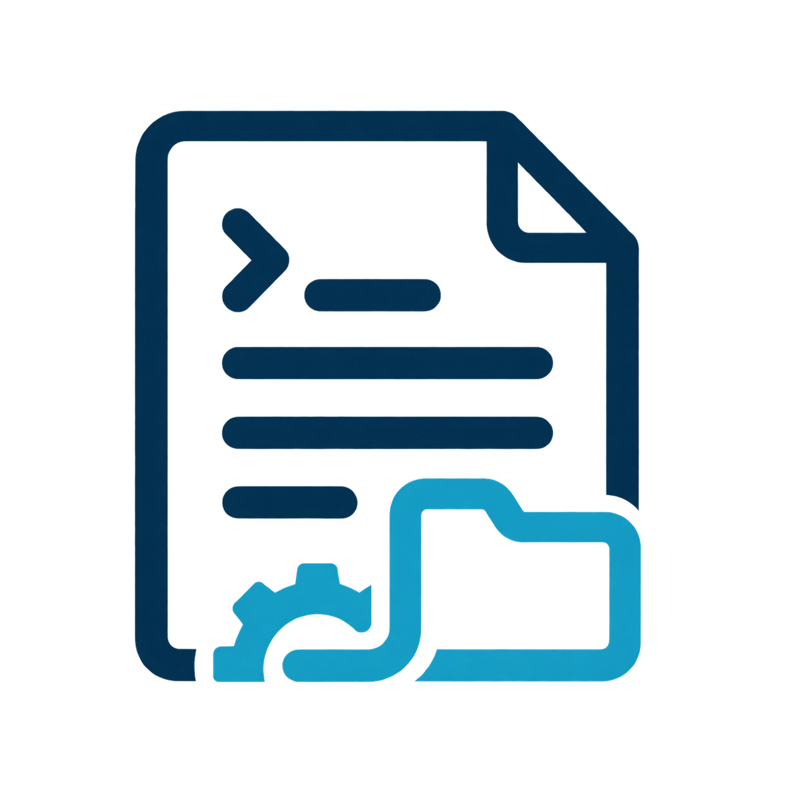
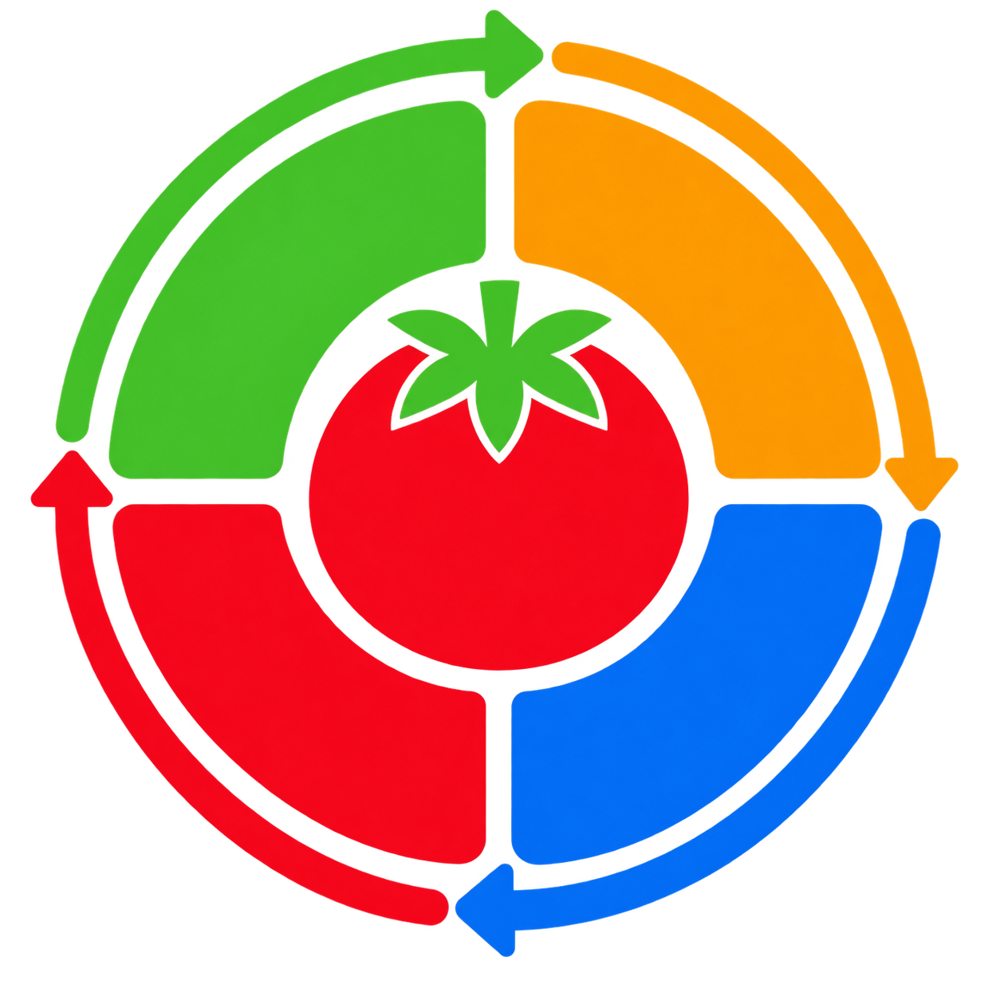
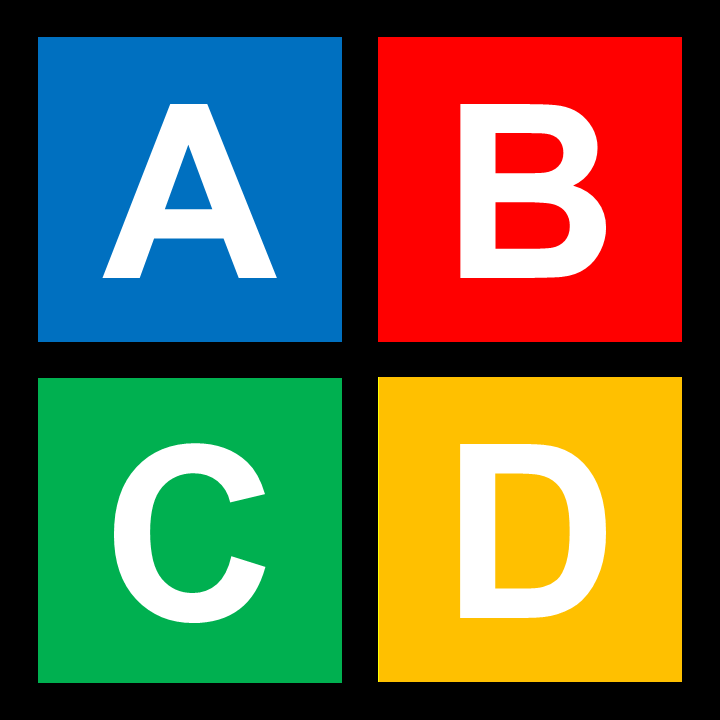
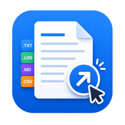

<!-- Multilanguage README.md for fernandoncidade Profile -->

  <b>Selecione o idioma / Select language:</b> 
  <a href="#ptbr">🇧🇷 Português (BR)</a> |
  <a href="#enus">🇺🇸 English (US)</a>

---

<h2 id="ptbr">🇧🇷 Português (BR)</h2>

> # Olá, eu sou o Fernando Nillsson Cidade! 👋

Clique para expandir o README em português

  
  
  

## 📊 Estatísticas dos Meus Repositórios

### 🕒 Total de Tempo Trabalhado: 40228.3h <!-- TOTAL_HOURS_PLACEHOLDER -->
### 📝 Total de Linhas Escritas: 432988 <!-- TOTAL_LINES_PLACEHOLDER -->
### 💻 Total de Commits: 397 <!-- TOTAL_COMMITS_PLACEHOLDER -->

## 📈 Detalhamento por Repositório

> Gerado automaticamente a partir da API pública do GitHub; repositórios privados e forks não entram neste relatório.

<!-- PUBLIC_REPOS_STATS_PT_START -->
| Repositório | Linguagem | Horas | Linhas | Commits | Produtividade (L/H) |
|-------------|-----------|-------|--------|---------|---------------|
| ACL_Auditor_cpp | C++ | 2796.6h | 23305 | 1 | 8.33 l/h |
| Agenda_Avaliacoes_Academicas | Python | 523.6h | 6545 | 11 | 12.50 l/h |
| Agenda_Avaliacoes_Academicas_cpp | C++ | 911.5h | 7596 | 3 | 8.33 l/h |
| Compare_Following_Follower | Python | 886.3h | 11079 | 5 | 12.50 l/h |
| Compression_Manager | Python | 569.9h | 5480 | 14 | 9.62 l/h |
| Dashboard_Streamlit-Plotly-Pandas_Management | Python | 58.5h | 1170 | 8 | 20.00 l/h |
| Dashboard_Streamlit-Plotly-Pandas_Pareto-Diagram_ABC-Curve | Python | 55.8h | 1116 | 3 | 20.00 l/h |
| Dashboard_Taipy | Python | 6059.6h | 100994 | 3 | 16.67 l/h |
| Dashboard_TkInter_Pareto-Diagram_ABC-Curve | Python | 67.8h | 1356 | 1 | 20.00 l/h |
| EcoLZMA_cpp | C++ | 1430.0h | 11917 | 1 | 8.33 l/h |
| Economia_APP | Python | 857.9h | 10724 | 15 | 12.50 l/h |
| Economia_APP_cpp | C++ | 2707.4h | 22562 | 2 | 8.33 l/h |
| fernandoncidade | HTML | 325.7h | 10178 | 248 | 31.25 l/h |
| File_Manager | C++ | 534.9h | 8024 | 5 | 15.00 l/h |
| Launcher_EBook | C++ | 352.2h | 3202 | 2 | 9.09 l/h |
| Linceu_Lighthouse_cpp | C++ | 16286.6h | 135722 | 4 | 8.33 l/h |
| Munin_App_cpp | C++ | 2286.0h | 19050 | 1 | 8.33 l/h |
| Programa_Carteira_Motorista | C++ | 21.5h | 387 | 2 | 18.00 l/h |
| Programa_Determinar_Maior_Inteiro | C++ | 10.0h | 150 | 2 | 15.00 l/h |
| Programa_Expressoes_Relacionais | C++ | 10.0h | 140 | 2 | 14.00 l/h |
| Programa_IMC | C++ | 10.0h | 169 | 2 | 16.90 l/h |
| Programa_Matriz_NM | C++ | 10.0h | 163 | 2 | 16.30 l/h |
| Programa_Media_Aritmetica | C++ | 21.4h | 385 | 2 | 17.99 l/h |
| Programa_Multiplo | C++ | 10.0h | 171 | 2 | 17.10 l/h |
| Programa_Quociente_Resto | C++ | 10.0h | 140 | 2 | 14.00 l/h |
| Programa_Todos_Tipos_Matrizes | C++ | 12.4h | 223 | 2 | 17.98 l/h |
| Programa_Urna_Eletronica | C++ | 744.4h | 11166 | 6 | 15.00 l/h |
| SlidingWindowLZ77_cpp | C | 2198.4h | 32976 | 1 | 15.00 l/h |
| sloth-highlander-theme-1 | CSS/HTML | 459.9h | 6898 | 45 | 15.00 l/h |
| **TOTAL** | - | 40228.3h | 432988 | 397 | - |
<!-- PUBLIC_REPOS_STATS_PT_END -->

## 🌻 Sobre Mim 🌻

Sou desenvolvedor de software com experiência sólida em C++ (C++17/C++20), Python e engenharia de interfaces gráficas desktop (GUI). Tenho foco em ferramentas de alta performance, auditoria de segurança de sistemas de arquivos, processamento de logs massivos em tempo real, automação e soluções práticas para o cotidiano, combinando Qt6, Win32 API, instruções SIMD e bancos locais com soberania total de dados (100% offline).

## 🚀 Habilidades

- **Linguagens:** C++ (C++17, C++20), Python (3.10+)
- **Desenvolvimento de GUI & Desktop:** Qt6 (Widgets, QSS, Mica/Windows DWM), PySide6, PyQt6, Tkinter
- **Sistemas & Performance:** Win32 API, Memory-Mapped Files (Zero-Copy), Instruções SIMD (AVX2, SSE4.2), Multithreading, SQLite Local
- **Segurança & Auditoria:** Permissões NTFS, Auditoria SMB, Análise de Acesso Efetivo (Effective Access), File Integrity Monitoring (FIM), ReadDirectoryChangesW, Hashes Criptográficos
- **Análise de Dados e Visualização:** Pandas, Plotly, Streamlit, Taipy
- **Científico e Numérico:** NumPy, SciPy, Matplotlib
- **Gerenciamento de Arquivos e Backup:** Automação, compressão de dados (LZMA, LZ77)
- **Metodologias de Organização e Produtividade:** Matriz de Eisenhower, Pomodoro, Método Feynman
- **Controle de Versionamento:** Git e GitHub

## 🏪 Aplicativos na Loja da Microsoft (Microsoft Store)

| Aplicativo | Ícone | Descrição | Microsoft Store | Repositório |
|---|:---:|---|:---:|:---:|
| **Linceu Lighthouse** |  | Plataforma local de inteligência, histórico e auditoria de arquivos (FIM) |  |  |
| **ACL Auditor** |  | Auditoria de permissões NTFS & SMB, cálculo de acesso efetivo e riscos |  |  |
| **Munin App** |  | Leitor de logs massivos ultraveloz com Memory-Mapped Files e SIMD |  |  |
| **EisenPo** |  | Gestão de tarefas por Matriz de Eisenhower com módulos Pomodoro e Feynman |  | — |
| **EISENHOWER ORGANIZER** |  | Organização e priorização ágil de tarefas pela Matriz de Eisenhower |  | — |
| **Lúmen** |  | Apoio a estudo, foco e organização para neurodivergentes (TEA, TDAH, Dislexia) |  | — |
| **COMPRESSION MANAGER** |  | Gerenciador de compressão e automação de backups multifórmato |  |  |
| **Economia APP** |  | Cálculos de Engenharia Econômica e finanças com passos detalhados |  |  |

---

## 🏮 Destaque de Projeto: Linceu Lighthouse

  

**Linceu Lighthouse**  
Plataforma desktop nativa em **C++17 e Qt6** para inteligência, rastreamento histórico e auditoria determinística do sistema de arquivos do Windows.
- **Monitoramento Semântico em Tempo Real:** Captura via APIs Win32 assíncronas (`ReadDirectoryChangesW`) com correlação de eventos complexos para identificação real de `RENAMED` e `MOVED`.
- **Inteligência Local sem IA:** Banco de dados relacional SQLite local enriquecido com mais de 30 categorias de metadados antes e depois de cada modificação, acompanhado por 17 visualizações gráficas nativas e mapas de calor.
- **Segurança e Linha de Base:** Linha de base criptográfica (baseline), cálculo determinístico de score de risco e exportação de relatórios auditáveis.
- **100% Local & Offline:** Zero nuvem, zero telemetria e isolamento completo.
- [Repositório GitHub: Linceu_Lighthouse_cpp](https://github.com/fernandoncidade/Linceu_Lighthouse_cpp)
- [Microsoft Web Store](https://apps.microsoft.com/detail/9NN8Z5Z700TM)
-    

## 🛡️ Destaque de Projeto: ACL Auditor

  

**ACL Auditor**  
Auditor enterprise-grade de permissões NTFS e compartilhamentos SMB no Windows, construído nativamente em **C++20 e Qt 6.11**.
- **Análise de Acesso Efetivo (Effective Access):** Responde com exatidão causal o motivo pelo qual um usuário ou grupo possui determinada permissão, simulando tokens, grupos aninhados e regras de herança.
- **Detecção de Riscos e Conformidade:** Identifica vulnerabilidades de segurança, diretórios graváveis por todos (*world-writable*), SIDs órfãos e caminhos de escalonamento de privilégios em serviços do Windows (caminhos não citados / *unquoted paths*).
- **Remediação Segura com Rollback:** Gera planos de remediação auditáveis garantindo backup obrigatório (`icacls /save`) e restauração segura (`icacls /restore`).
- **Relatórios Auditáveis:** Exportação completa de snapshots e relatórios técnicos em HTML e PDF.
- [Repositório GitHub: ACL_Auditor_cpp](https://github.com/fernandoncidade/ACL_Auditor_cpp)
- [Microsoft Web Store](https://apps.microsoft.com/detail/9NX5XZLL8WXW)
-    

## ⚡ Destaque de Projeto: Munin App

  

**Munin App**  
Visualizador e analisador de logs massivos de altíssimo desempenho para Windows, arquitetado em **C++20 com Qt6**.
- **Abertura Instantânea de Gigabytes:** Leitura *zero-copy* sob demanda via *Memory-Mapped Files* Win32 (`CreateFileMappingW` e `MapViewOfFile`), eliminando esgotamento de memória RAM.
- **Indexação SIMD > 3 GB/s:** Escaneamento vetorial ultrarrápido com instruções AVX2 e SSE4.2 com fallback escalar para indexar offsets em tempo recorde.
- **Busca Paralela Multi-Core:** Particionamento dinâmico entre todos os núcleos de CPU com suporte a Regex JIT e filtragem instantânea de linhas.
- **Live Tail & Time-Slice:** Acompanhamento contínuo em tempo real via eventos do kernel sem loops de polling e histograma temporal de distribuição de volume por carimbos de data/hora.
- **Inspetor Hierárquico JSON:** Dissecação e árvore formatada com realce sintático para logs estruturados modernos.
- [Repositório GitHub: Munin_App_cpp](https://github.com/fernandoncidade/Munin_App_cpp)
- [Microsoft Web Store](https://apps.microsoft.com/detail/9PP4GVHR5THC)
-    

## 📋 Destaque de Projeto: EisenPo

  

**EisenPo**  
Aplicação desktop nativa em **C++ e Qt6** para organização e priorização de tarefas com base na Matriz de Eisenhower (Urgente/Importante).
- **Quatro Quadrantes Dinâmicos:** Classificação ágil entre tarefas pendentes e concluídas com movimentação automática.
- **Exportação & Importação:** Suporte a planilhas Excel (XLSX), arquivos PDF estruturados e persistência local segura em JSON.
- **Módulos e Plugins Opcionais:** Inclui módulo de foco Pomodoro com ciclos de trabalho/pausa sincronizados e integração com o Método Feynman para aprendizado e revisão ativa de conceitos.
- **Visualização Temporal:** Calendário integrado para exibição de tarefas por dia, semana e mês.
- [Microsoft Web Store](https://apps.microsoft.com/detail/9MW96RN044TT)
-   

## 🌟 Destaque de Projeto: Lúmen

  

**Lúmen**  
Aplicativo desktop em **C++ e Qt6** voltado para apoiar jovens e adultos neurodivergentes (TEA, TDAH, Dislexia) no estudo, foco e organização pessoal.
- Integra leitor acessível com vozes neurais, ferramentas de priorização de tarefas, timers Pomodoro com alertas visuais suaves, mapas mentais e recursos para explicação ativa (Método Feynman).
- [Microsoft Web Store](https://apps.microsoft.com/detail/9N70CLLMVRPN)
-   

## 🗂️ Destaque de Projeto: Eisenhower Organizer

  

**Eisenhower Organizer**  
Aplicativo leve e rápido para organizar tarefas usando a Matriz de Eisenhower (Importante/Urgente). Permite criar, classificar, marcar como concluídas e exportar/importar tarefas de forma simples e intuitiva.
- [Microsoft Web Store](https://apps.microsoft.com/detail/9P289X0185C3)
-  

## 📦 Destaque de Projeto: Compression Manager

  

**Compression Manager**  
Aplicativo desktop completo para automação de backups e compressão de arquivos. Conta com interface gráfica intuitiva, suporte a múltiplos formatos de arquivamento e perfis rápidos de backup.
- [Repositório GitHub: Compression_Manager](https://github.com/fernandoncidade/Compression_Manager)
- [Microsoft Web Store](https://apps.microsoft.com/detail/9PJMT90R953K)
-  

## 💰 Destaque de Projeto: Economia APP

  

**Economia APP**  
Ferramenta para cálculos financeiros e suporte à disciplina de Engenharia Econômica. Automatiza cálculos de juros simples e compostos, anuidades, gradientes, equivalência de taxas, tabelas de amortização (SAC, Price, SAM), análise de viabilidade de investimentos (VPL / VAUE) e depreciação com memória de cálculo detalhada.
- [Repositório GitHub: Economia_APP](https://github.com/fernandoncidade/Economia_APP)
- [Repositório GitHub: Economia_APP_cpp](https://github.com/fernandoncidade/Economia_APP_cpp)
- [Microsoft Web Store](https://apps.microsoft.com/detail/9PLR0KD6KSJJ)
-   

## 📚 Destaque de Projeto: Launcher EBook

  

**Launcher EBook**  
Aplicação desktop nativa em **C++/Qt6** para catalogar e-books e documentos locais, exibir metadados básicos, gerar estatísticas de acervo e abrir arquivos com aplicativos associados do sistema ou com um executável personalizado.
- [Repositório GitHub: Launcher_EBook](https://github.com/fernandoncidade/Launcher_EBook)
-  

## 👥 Destaque de Projeto: Compare - Following and Follower

  

**Compare - Following and Follower**  
Aplicativo desktop em Python/PySide6 para comparar, de forma prática e visual, quem você segue e quem te segue no GitHub, transformando grandes listas em relatórios claros para gestão do seu perfil.
- [Repositório GitHub: Compare_Following_Follower](https://github.com/fernandoncidade/Compare_Following_Follower)
-  

## 🎯 Principais Projetos

- [**Linceu Lighthouse**](https://github.com/fernandoncidade/Linceu_Lighthouse_cpp): Plataforma local de inteligência, histórico e auditoria determinística de atividades de arquivos no Windows (C++17 / Qt6 / SQLite).
- [**ACL Auditor**](https://github.com/fernandoncidade/ACL_Auditor_cpp): Auditor enterprise-grade de permissões NTFS e compartilhamentos SMB com análise de acesso efetivo e riscos (C++20 / Qt 6.11).
- [**Munin App**](https://github.com/fernandoncidade/Munin_App_cpp): Visualizador de logs massivos ultraveloz com Win32 Memory-Mapped Files e aceleração SIMD AVX2/SSE4.2 (C++20 / Qt6).
- [**Compression Manager**](https://github.com/fernandoncidade/Compression_Manager): Aplicativo completo de backup e compressão de arquivos com interface gráfica intuitiva.
- [**Economia APP**](https://github.com/fernandoncidade/Economia_APP): Ferramenta para cálculos financeiros e Engenharia Econômica com passos detalhados e histórico.
- [**Launcher EBook**](https://github.com/fernandoncidade/Launcher_EBook): Aplicação desktop em C++/Qt6 para catalogação de e-books e documentos locais.
- [**Agenda Avaliações Acadêmicas**](https://github.com/fernandoncidade/Agenda_Avaliacoes_Academicas): Sistema para gerenciamento de atividades avaliativas em ambientes educacionais, usando PySide6.
- [**Compare - Following and Follower**](https://github.com/fernandoncidade/Compare_Following_Follower): Aplicativo desktop para comparar seguidores e seguidos no GitHub.
- [**Programa Urna Eletrônica**](https://github.com/fernandoncidade/Programa_Urna_Eletronica): Sistema de votação eletrônica em C++, simulando urna com apuração automática.

## 📊 Dashboards de Análise de Dados
- [Streamlit/Plotly/Pandas Management](https://github.com/fernandoncidade/Dashboard_Streamlit-Plotly-Pandas_Management)
- [Pareto Diagram/ABC Curve](https://github.com/fernandoncidade/Dashboard_Streamlit-Plotly-Pandas_Pareto-Diagram_ABC-Curve)
- [TkInter Pareto/ABC](https://github.com/fernandoncidade/Dashboard_TkInter_Pareto-Diagram_ABC-Curve)

## 🎓 Formação Acadêmica

*Atualmente sou aluno do curso de Bacharelado em Engenharia Civil, da Universidade Federal do Paraná. Anteriormente cursei Licenciatura em Física na Universidade Tecnológica Federal do Paraná, tenho experiência em docência para o Ensino Médio.*

## 🎯 Objetivos

- Aprimorar conhecimentos em automação, análise de dados e inteligência artificial.
- Ampliar o desenvolvimento de soluções open source e contribuir para a comunidade.
- Explorar novas tecnologias e padrões de desenvolvimento para entregar projetos cada vez mais robustos e eficientes.

  

## 📫 Contato

---

## 📈 Estatísticas GitHub

  

 <em><b>Sempre codando com paixão!</b> 🚀</em> 

  

---

<h2 id="enus">🇺🇸 English (US)</h2>

> # Hello, I'm Fernando Nillsson Cidade! 👋

Click to expand the README in English

  
  
  

## 📊 My Repository Statistics

### 🕒 Total Working Time: 40228.3h <!-- TOTAL_HOURS_PLACEHOLDER -->
### 📝 Total Lines Written: 432988 <!-- TOTAL_LINES_PLACEHOLDER -->
### 💻 Total Commits: 397 <!-- TOTAL_COMMITS_PLACEHOLDER -->

## 📈 Repository Breakdown

> Generated automatically from GitHub's public API; private repositories and forks are not included in this report.

<!-- PUBLIC_REPOS_STATS_EN_START -->
| Repository | Language | Hours | Lines | Commits | Productivity (L/H) |
|------------|----------|-------|-------|---------|--------------|
| ACL_Auditor_cpp | C++ | 2796.6h | 23305 | 1 | 8.33 l/h |
| Agenda_Avaliacoes_Academicas | Python | 523.6h | 6545 | 11 | 12.50 l/h |
| Agenda_Avaliacoes_Academicas_cpp | C++ | 911.5h | 7596 | 3 | 8.33 l/h |
| Compare_Following_Follower | Python | 886.3h | 11079 | 5 | 12.50 l/h |
| Compression_Manager | Python | 569.9h | 5480 | 14 | 9.62 l/h |
| Dashboard_Streamlit-Plotly-Pandas_Management | Python | 58.5h | 1170 | 8 | 20.00 l/h |
| Dashboard_Streamlit-Plotly-Pandas_Pareto-Diagram_ABC-Curve | Python | 55.8h | 1116 | 3 | 20.00 l/h |
| Dashboard_Taipy | Python | 6059.6h | 100994 | 3 | 16.67 l/h |
| Dashboard_TkInter_Pareto-Diagram_ABC-Curve | Python | 67.8h | 1356 | 1 | 20.00 l/h |
| EcoLZMA_cpp | C++ | 1430.0h | 11917 | 1 | 8.33 l/h |
| Economia_APP | Python | 857.9h | 10724 | 15 | 12.50 l/h |
| Economia_APP_cpp | C++ | 2707.4h | 22562 | 2 | 8.33 l/h |
| fernandoncidade | HTML | 325.7h | 10178 | 248 | 31.25 l/h |
| File_Manager | C++ | 534.9h | 8024 | 5 | 15.00 l/h |
| Launcher_EBook | C++ | 352.2h | 3202 | 2 | 9.09 l/h |
| Linceu_Lighthouse_cpp | C++ | 16286.6h | 135722 | 4 | 8.33 l/h |
| Munin_App_cpp | C++ | 2286.0h | 19050 | 1 | 8.33 l/h |
| Programa_Carteira_Motorista | C++ | 21.5h | 387 | 2 | 18.00 l/h |
| Programa_Determinar_Maior_Inteiro | C++ | 10.0h | 150 | 2 | 15.00 l/h |
| Programa_Expressoes_Relacionais | C++ | 10.0h | 140 | 2 | 14.00 l/h |
| Programa_IMC | C++ | 10.0h | 169 | 2 | 16.90 l/h |
| Programa_Matriz_NM | C++ | 10.0h | 163 | 2 | 16.30 l/h |
| Programa_Media_Aritmetica | C++ | 21.4h | 385 | 2 | 17.99 l/h |
| Programa_Multiplo | C++ | 10.0h | 171 | 2 | 17.10 l/h |
| Programa_Quociente_Resto | C++ | 10.0h | 140 | 2 | 14.00 l/h |
| Programa_Todos_Tipos_Matrizes | C++ | 12.4h | 223 | 2 | 17.98 l/h |
| Programa_Urna_Eletronica | C++ | 744.4h | 11166 | 6 | 15.00 l/h |
| SlidingWindowLZ77_cpp | C | 2198.4h | 32976 | 1 | 15.00 l/h |
| sloth-highlander-theme-1 | CSS/HTML | 459.9h | 6898 | 45 | 15.00 l/h |
| **TOTAL** | - | 40228.3h | 432988 | 397 | - |
<!-- PUBLIC_REPOS_STATS_EN_END -->

## 🌻 About Me 🌻

I'm a software developer with solid experience in C++ (C++17/C++20), Python, and desktop graphical user interface (GUI) engineering. My work focuses on high-performance tooling, file system security auditing, real-time massive log parsing, automation, and everyday workflow utilities, leveraging Qt6, the Win32 API, SIMD vector instructions, and local databases with total data sovereignty (100% offline).

## 🚀 Skills

- **Languages:** C++ (C++17, C++20), Python (3.10+)
- **GUI & Desktop Development:** Qt6 (Widgets, QSS, Mica/Windows DWM), PySide6, PyQt6, Tkinter
- **Systems & Performance:** Win32 API, Memory-Mapped Files (Zero-Copy), SIMD Vector Instructions (AVX2, SSE4.2), Multithreading, Local SQLite
- **Security & Auditing:** NTFS Permissions, SMB Share Auditing, Effective Access Analysis, File Integrity Monitoring (FIM), ReadDirectoryChangesW, Cryptographic Hashes
- **Data Analysis & Visualization:** Pandas, Plotly, Streamlit, Taipy
- **Scientific & Numerical:** NumPy, SciPy, Matplotlib
- **File Management & Backup:** Automation, data compression (LZMA, LZ77)
- **Productivity & Methodologies:** Eisenhower Matrix, Pomodoro, Feynman Technique
- **Version Control:** Git and GitHub

## 🏪 Microsoft Store Applications

| Application | Icon | Description | Microsoft Store | Repository |
|---|:---:|---|:---:|:---:|
| **Linceu Lighthouse** |  | Local file activity intelligence, history, and audit platform (FIM) |  |  |
| **ACL Auditor** |  | Windows NTFS & SMB permission auditor, effective access & risk detection |  |  |
| **Munin App** |  | Ultra-high performance massive log reader with Win32 Memory-Mapped Files & SIMD |  |  |
| **EisenPo** |  | Eisenhower Matrix task management with integrated Pomodoro & Feynman modules |  | — |
| **EISENHOWER ORGANIZER** |  | Agile task organization & prioritization using the Eisenhower Matrix |  | — |
| **Lúmen** |  | Study, focus & organization assistant for neurodivergent individuals (ASD, ADHD, Dyslexia) |  | — |
| **COMPRESSION MANAGER** |  | Multiformat archive compression and backup automation manager |  |  |
| **Economia APP** |  | Engineering Economics & financial calculations with detailed step-by-step memory |  |  |

---

## 🏮 Project Highlight: Linceu Lighthouse

  

**Linceu Lighthouse**  
Native Windows desktop application engineered in **C++17 and Qt6** providing deterministic intelligence, historical timeline tracking, and auditing over the file system.
- **Real-Time Semantic Monitoring:** Captures system events via asynchronous Win32 APIs (`ReadDirectoryChangesW`) with complex correlation algorithms to detect true `RENAMED` and `MOVED` operations.
- **Local Intelligence without AI:** Automatic local SQLite database enriched with 30+ metadata categories before and after each modification, accompanied by 17 native charts and heatmaps.
- **Cryptographic Baseline & Security:** Cryptographic integrity baselines, deterministic risk scoring, and audit-ready report generation.
- **100% Local & Offline:** Zero cloud, zero telemetry, and complete network isolation.
- [GitHub Repository: Linceu_Lighthouse_cpp](https://github.com/fernandoncidade/Linceu_Lighthouse_cpp)
- [Microsoft Web Store](https://apps.microsoft.com/detail/9NN8Z5Z700TM)
-    

## 🛡️ Project Highlight: ACL Auditor

  

**ACL Auditor**  
Enterprise-grade Windows NTFS and SMB permission auditor and security risk analyzer engineered in **C++20 and Qt 6.11**.
- **Effective Access Explanation:** Decodes causal permission access for any user or group, simulating token evaluation, nested groups, and inheritance chains.
- **Risk & Vulnerability Detection:** Discovers security misconfigurations, world-writable directories, orphaned SIDs, and privilege escalation vectors in Windows services (unquoted service paths, writable executables).
- **Safe Remediation with Guaranteed Rollback:** Generates auditable PowerShell/batch scripts enforcing mandatory backups (`icacls /save`) and guaranteed restoration (`icacls /restore`).
- **Auditable Reports:** Comprehensive snapshots and technical exports formatted in HTML and PDF.
- [GitHub Repository: ACL_Auditor_cpp](https://github.com/fernandoncidade/ACL_Auditor_cpp)
- [Microsoft Web Store](https://apps.microsoft.com/detail/9NX5XZLL8WXW)
-    

## ⚡ Project Highlight: Munin App

  

**Munin App**  
High-performance massive log reader and diagnostic analyzer for Windows, designed natively in **C++20 with Qt6**.
- **Instant Gigabyte File Opening:** Zero-copy on-demand paging via Win32 *Memory-Mapped Files* (`CreateFileMappingW` and `MapViewOfFile`), eliminating RAM exhaustion.
- **SIMD Indexing > 3 GB/s:** High-speed vector parsing with AVX2 and SSE4.2 instructions and scalar fallback to index line offsets in milliseconds.
- **Multi-Core Parallel Search:** Partitioned search across all CPU logical cores with JIT Regex matching and instant line filtering.
- **Live Tail & Time-Slice Histogram:** Continuous real-time log monitoring via Windows kernel notifications without polling loops, plus timestamp distribution histograms for anomaly detection.
- **Hierarchical JSON Inspector:** Interactive syntax-highlighted tree panel for modern structured logs.
- [GitHub Repository: Munin_App_cpp](https://github.com/fernandoncidade/Munin_App_cpp)
- [Microsoft Web Store](https://apps.microsoft.com/detail/9PP4GVHR5THC)
-    

## 📋 Project Highlight: EisenPo

  

**EisenPo**  
Native desktop productivity application in **C++ and Qt6** for organizing and prioritizing tasks through the Eisenhower Matrix (Urgent/Important).
- **Four Dynamic Quadrants:** Agile sorting between pending and completed tasks with automatic list transitions.
- **Export & Import Support:** Full support for Excel spreadsheets (XLSX), structured PDF files, and persistent local JSON.
- **Optional Plugins & Modules:** Dedicated Pomodoro focus module with synchronized work/break intervals and Feynman Technique integration for conceptual study and active review.
- **Calendar & Timeline View:** Visual inspection of scheduled tasks by day, week, and month.
- [Microsoft Web Store](https://apps.microsoft.com/detail/9MW96RN044TT)
-   

## 🌟 Project Highlight: Lúmen

  

**Lúmen**  
Desktop application built in **C++ and Qt6** designed to assist neurodivergent students and professionals (ASD, ADHD, Dyslexia) in studying, focusing, and task management.
- Integrates an accessible reader with neural voice support, prioritization utilities, Pomodoro timers with gentle visual cues, mind mapping, and active explanation tools (Feynman Method).
- [Microsoft Web Store](https://apps.microsoft.com/detail/9N70CLLMVRPN)
-   

## 🗂️ Project Highlight: Eisenhower Organizer

  

**Eisenhower Organizer**  
Lightweight and agile task manager based on the Eisenhower Matrix (Important/Urgent). Allows creating, categorizing, marking as completed, and importing/exporting tasks with speed and simplicity.
- [Microsoft Web Store](https://apps.microsoft.com/detail/9P289X0185C3)
-  

## 📦 Project Highlight: Compression Manager

  

**Compression Manager**  
Comprehensive desktop application for automated backups and file compression with an intuitive user interface and multiformat archive support.
- [GitHub Repository: Compression_Manager](https://github.com/fernandoncidade/Compression_Manager)
- [Microsoft Web Store](https://apps.microsoft.com/detail/9PJMT90R953K)
-  

## 💰 Project Highlight: Economia APP

  

**Economia APP**  
Study and professional calculation aid for Engineering Economics. Automates frequent financial computations (simple/compound interest, annuities, gradients, rate equivalence, amortization schedules SAC/Price/SAM, NPV, EUAW, and depreciation) with step-by-step solution history.
- [GitHub Repository: Economia_APP](https://github.com/fernandoncidade/Economia_APP)
- [GitHub Repository: Economia_APP_cpp](https://github.com/fernandoncidade/Economia_APP_cpp)
- [Microsoft Web Store](https://apps.microsoft.com/detail/9PLR0KD6KSJJ)
-   

## 📚 Project Highlight: Launcher EBook

  

**Launcher EBook**  
C++/Qt6 desktop application for cataloging local e-books and documents, displaying essential metadata, computing collection statistics, and opening files with default system viewers or a custom executable.
- [GitHub Repository: Launcher_EBook](https://github.com/fernandoncidade/Launcher_EBook)
-  

## 👥 Project Highlight: Compare - Following and Follower

  

**Compare - Following and Follower**  
Python/PySide6 desktop app to easily audit and compare your GitHub connections (who you follow vs. who follows you back), transforming long follower lists into clean, actionable decisions.
- [GitHub Repository: Compare_Following_Follower](https://github.com/fernandoncidade/Compare_Following_Follower)
-  

## 🎯 Main Projects

- [**Linceu Lighthouse**](https://github.com/fernandoncidade/Linceu_Lighthouse_cpp): Local file activity intelligence, history, and deterministic audit platform for Windows (C++17 / Qt6 / SQLite).
- [**ACL Auditor**](https://github.com/fernandoncidade/ACL_Auditor_cpp): Enterprise-grade Windows NTFS & SMB permission auditor with effective access explanation and risk detection (C++20 / Qt 6.11).
- [**Munin App**](https://github.com/fernandoncidade/Munin_App_cpp): Ultra-fast massive log viewer and analyzer leveraging Win32 Memory-Mapped Files and SIMD acceleration (C++20 / Qt6).
- [**Compression Manager**](https://github.com/fernandoncidade/Compression_Manager): Comprehensive backup and file compression application with an intuitive GUI.
- [**Economia APP**](https://github.com/fernandoncidade/Economia_APP): Financial and Engineering Economics calculation tool with detailed step-by-step history.
- [**Launcher EBook**](https://github.com/fernandoncidade/Launcher_EBook): C++/Qt6 desktop application for cataloging local e-books and documents.
- [**Academic Evaluations Scheduler**](https://github.com/fernandoncidade/Agenda_Avaliacoes_Academicas): System for managing academic assessment activities using PySide6.
- [**Compare - Following and Follower**](https://github.com/fernandoncidade/Compare_Following_Follower): Desktop app to compare followers and following on GitHub.
- [**Electronic Ballot Program**](https://github.com/fernandoncidade/Programa_Urna_Eletronica): Electronic voting system in C++, simulating an electronic ballot box with automatic tallying.

## 📊 Data Analysis Dashboards
- [Streamlit/Plotly/Pandas Management](https://github.com/fernandoncidade/Dashboard_Streamlit-Plotly-Pandas_Management)
- [Pareto Diagram/ABC Curve](https://github.com/fernandoncidade/Dashboard_Streamlit-Plotly-Pandas_Pareto-Diagram_ABC-Curve)
- [TkInter Pareto/ABC](https://github.com/fernandoncidade/Dashboard_TkInter_Pareto-Diagram_ABC-Curve)

## 🎓 Academic Background

*Currently a student of Civil Engineering at the Federal University of Paraná. Previously studied Physics Teaching at the Federal Technological University of Paraná, with experience teaching high school.*

## 🎯 Goals

- Improve knowledge in automation, data analysis, and artificial intelligence.
- Expand the development of open source solutions and contribute to the community.
- Explore new technologies and development standards to deliver increasingly robust and efficient projects.

  

## 📫 Contact

---

## 📈 GitHub Stats

  

 <em><b>Always coding with passion!</b> 🚀</em> 

  

